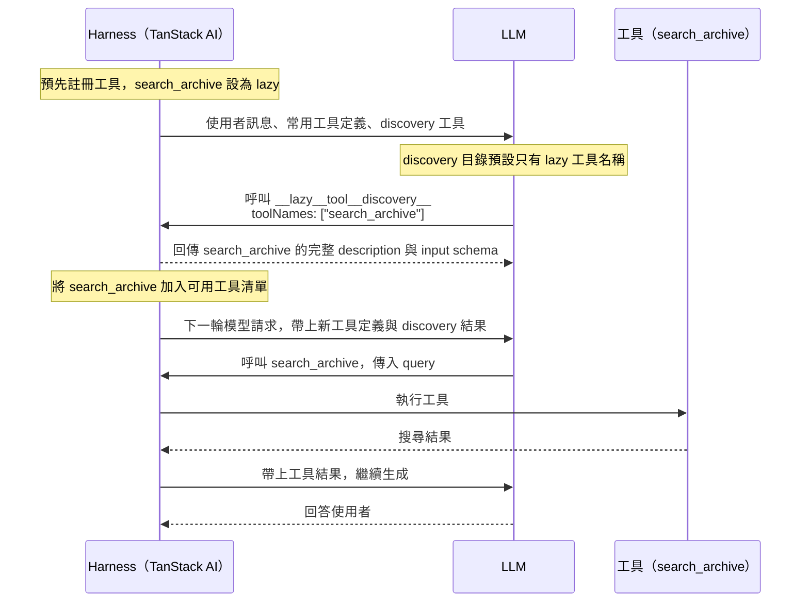
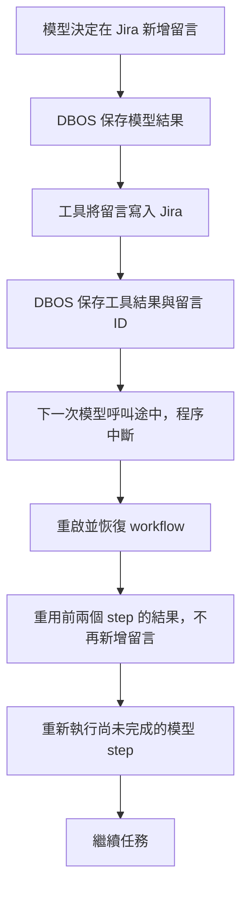
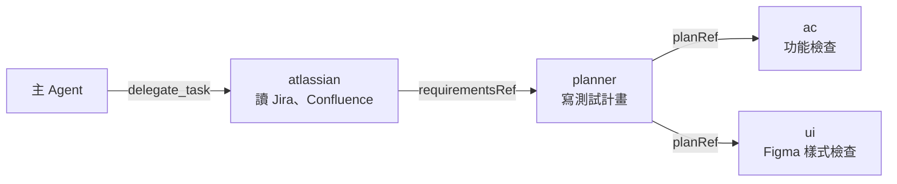
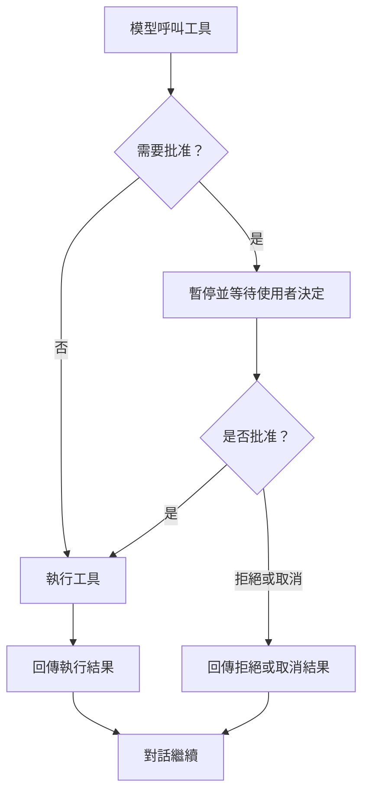

## Before Start

> [!NOTE]
> 此專案為公司內部教學用專案，透過 Coding Agent 建立 Harness 的系統，客製化自己的 Workflow。  
> 部分 Code 會使用手動編輯的方式，避免整個方向歪掉。  
> 不限定使用的 Agent 工具，以理解 Harness 觀念為主。  
> 我會使用 [PI](https://pi.dev/) 進行開發，搭配 [pstack](https://github.com/backnotprop/pstack)。

我的個人配置：

- [skills](https://github.com/tp6gw94/skills)
- [pi](https://github.com/tp6gw94/my-pi)

> 和 Agent 協作，就像是監督比你聰明的人一起工作。

需要給他你要的方向，但又不能太過限定他們的發展。

透過間接 Prompt 的方式，讓 Agent 說出他要怎麼做，同時也讓自己確認 Agent 沒有偏離方向。


> AI 時代的工程師應該都要有自己的 Agent Flow。自己打造自己的 Agent，理解背後的魔法。

[if your team is too busy doing their 'normal job' to experiment with AI, you're preparing them to be replaced](https://ghuntley.com/replaced/)

每個公司、團隊、個人都會有自己的開發方式，所以不會特定要求要使用什麼 SDD、Plan、grill-me 等，不會特別的說明各使用方式，每個方法都很好，找到你自己合適的，我會用我自己的方式進行開發，互相參考學習。

而是要建立屬於自己且滿足團隊的自動化 Flow。

> [!IMPORTANT]
> 你的電腦應該要安裝 Docker & node >= 22  
> 預期你了解部分 TypeScript 以及前後端

### 參考解答

每一節都有一個參考解答的 branch，每個 branch 都以前一節為基礎：

| 節 | Branch |
| --- | --- |
| 起點 | `workshop/00-start` |
| 1. Tool | `workshop/01-tools` |
| 2. Durable Execution | `workshop/02-durable` |
| 3. Code Mode | `workshop/03-code-mode` |
| 4. Compact | `workshop/04-compact` |
| 5. Agent Routing / Subagent | `workshop/05-subagents` |
| 6. User Approve | `workshop/06-approval` |

從 `workshop/00-start` 開始開發：

```bash
git switch -c my-harness origin/workshop/00-start
```

實作指引只放在 `main` 的 `docs/`，workshop branch 上沒有。開發時另外開著 GitHub 上 `main` 的 README。

卡住時，看那一節完整的變更：

```bash
git diff origin/workshop/04-compact origin/workshop/05-subagents
```

## 0. Intro

Agent = Model + Harness

好的 Harness 搭配不怎麼樣的模型能力可能大於強大的模型搭配不好的 Harness。

目標：建立會閱讀 Jira 和 Confluence 的 Agent，替我們撰寫 test case，並操作瀏覽器進行真實的測試，記錄下來結果。

> [!NOTE]
> Generate Share Token: 期限 4h
 
```bash
curl -X POST "https://api.deepinfra.com/v1/scoped-jwt" \
  -H "Content-Type: application/json" \
  -H "Authorization: Bearer $DEEPINFRA_API_KEY" \
  -d '{
      "api_key_name": "auto",
      "models": ["deepseek-ai/DeepSeek-V4-Flash-0731"],
      "expires_delta": 14400,
      "spending_limit": 1.0
  }'

```

### 暖身

1. 處理 openui 點擊訊息給 llm

## 1. Tool

LLM 要使用 tool 時，底層會透過特殊的 Token 進行輸出(通常在訓練後進行 fine-tuned 做處理)，以 `<|tool_call|>`, `<|end_tool_call|>` 當作範例，實際上這個 Token 不代表任何的文字：

```text
<|tool_call|>
{
  "name": "get_current_weather",
  "arguments": {
    "location": "Austin, TX, USA"
  }
}
<|end_tool_call|>
```

意思為要使用 `get_current_weather` 的這個 tool。

Harness 系統看到這 Token 的時候，瞭解到需要暫停 LLM 的執行，然後去執行這個 tool。

執行結束後，Harness 會以另一個標記，以`<|tool_result|>`, `<|end_tool_result|>` 告訴 LLM 執行的結果：

```text
<|tool_result|>
{
  "location": "Austin, TX, USA",
  "temperature": 93,
  "unit": "fahrenheit",
  "conditions": "sunny"
}
<|end_tool_result|>
```

這些特殊 token 無法由人類輸入產生，所以模型會知道哪些是 tool 執行的結果。

### MCP

被污名化已久的 Tool。

他就是 Tool，只是 MCP 內有很多的 Tool，所以佔滿了整個 context。

端看 Harness 會怎麼處理 MCP，像是 Lazy 或是手動處發。

MCP 就是包了許多外部 API 的 Tool。

### Lazy Load



### Target

建立兩組工具，讓 Agent 讀取 Figma、Jira 與 Confluence，把整理結果寫入本機檔案，再讀回確認。

- [ ] 建立 `get_figma` 與 [pi](https://deepwiki.com/search/how-to-implement-write-tool_dd9d3f11-2d60-43de-ad92-c95d2ace2da1?mode=fast) fs 工具 `read`、`write`、`edit`。
    
- [ ] 接入本機唯讀 Atlassian MCP，使用 lazy discovery 載入工具。

依序閱讀以下文件：

1. [工具架構](docs/tools/architecture.md)：檔案分工、資料流與 lazy discovery 的用途。
2. [建立自訂工具](docs/tools/custom-tools.md)：get_figma、Pi fs、聊天整合與測試。
3. [接入本機 Atlassian MCP](docs/tools/atlassian-mcp.md)：連線政策、服務程序、client、串流清理與串接驗收。


## 2. Durable Execution

**Agent 已經修改 Jira 狀態或新增留言，程序卻在下一秒中斷，重啟後該從哪裡繼續？**

Durable Execution（持久化執行）會把每個步驟的結果存成 checkpoint（檢查點）。重啟後重用已完成的結果，從尚未完成的步驟繼續。設計 Harness 時，要把一次 Agent 呼叫拆成**可追蹤、可恢復，也能安全重試的執行流程**。

### 程序中斷後，哪些東西會消失？

以只把狀態存在記憶體的 Agent 為例，請它讀取 Jira ticket、改成「進行中」，再留言說明處理方向。執行途中按下 `Ctrl-C` 關掉伺服器，會遇到兩個問題。

1. 記憶體裡的 `messages` 陣列消失。重啟後，Agent 不知道先前做過哪些工作。
2. Jira 上的狀態與留言仍然存在。直接重跑整個任務，可能重複新增留言；已完成的狀態轉換也可能無法再次執行。

只加 retry 或保存對話紀錄都不夠。Harness 還需要知道哪些步驟已完成。修改 Jira 狀態與新增留言會改變外部系統，這類操作稱為副作用（side effect）。

### Harness 增加兩種持久化紀錄

兩者都存進 Postgres，但用途不同。

- **DBOS 保存執行進度**：透過 [DBOS](https://docs.dbos.dev)，把每次模型呼叫與工具呼叫包成 step，記錄完成結果。重啟後，已完成 checkpoint 的 step 直接重用結果，不再呼叫模型或工具。
- **Drizzle 保存事件紀錄**：把原本存在記憶體裡的事件寫進 Postgres，讓 inspector 在重啟後仍能重播整段執行時間線。

以下流程示範 Jira 留言已寫入、工具的 checkpoint 也已保存，下一次模型呼叫卻在途中中斷的情況。



Checkpoint 決定恢復時要執行哪些步驟；事件紀錄則讓人看得見執行過程。

### Checkpoint 與副作用之間的空窗

如果 Jira 已經接受狀態更新或新增留言，DBOS 還沒保存工具的 checkpoint，程序就中斷，恢復時仍可能再次執行該工具。**持久化執行不會自動讓外部副作用只發生一次。**

工具需要冪等設計，讓同一個操作重試時不會重複生效。更新狀態前，可以先確認 ticket 是否已在目標狀態；新增留言則需要固定的操作識別碼與去重機制，區分「重試同一則留言」和「刻意再留言一次」。

只在本地記錄「已完成」仍有空窗：Jira 寫入成功後，本地紀錄也可能尚未保存。去重流程必須能確認 Jira 上的寫入結果，不能只依賴 DBOS checkpoint 或本地旗標。

### Target

建立可在程序重啟後接續的聊天 run，讓模型呼叫、工具結果與執行進度都有明確的保存邊界。

- [ ] 接手原生 `chat()` 的工具迴圈，將模型呼叫與每個工具呼叫拆成 DBOS steps。
- [ ] 保存 run、事件與對話終態，讓背景工作和 SSE 連線分開，支援重啟恢復與前端重連。
- [ ] 建立 `discover_atlassian_tools`，從持久化訊息重建 lazy discovery 狀態。
- [ ] 驗證 checkpoint 前後中斷的差異，以及工具副作用的重試風險。

依序閱讀以下文件：

1. [可恢復的聊天架構](docs/durable-execution/architecture.md)：模組責任、資料流與 checkpoint 邊界。
2. [建立可恢復的 run](docs/durable-execution/implement-run.md)：資料契約、模型與工具 steps、runtime 及 SSE 重連。
3. [建立可恢復的 lazy discovery](docs/durable-execution/lazy-discovery.md)：工具目錄、discovery 結果與恢復後的執行檢查。
4. [驗證中斷與重連](docs/durable-execution/verify-recovery.md)：離線測試、真實程序中斷與交付驗收。

## 3.Code Mode

- LLM 訓練時的時候看過很多 Code，他們擅長寫 Code (好不好另說)
- 將 Tool 交給 LLM 當成程式執行省去好幾 Run 可以節省 token
- LLM 只讀取最後的結果

Code Mode 就是給 LLM 一個 Sandbox，讓他可以在裡面執行程式，我們給他有哪些定義好的 Function 可以執行。

讓他可以自由運用順序、讀取等。


### Target

建立 `codemode`，讓模型用 TypeScript 編排當輪可用的工具，回傳整理後的結果。

- [ ] 接入 QuickJS 隔離執行，讓 `external_*` 經過共用工具 dispatcher。
- [ ] 從同一份 bindings 產生模型說明，並沿用可恢復的 lazy discovery。
- [ ] 限制執行時間、記憶體、工具呼叫與輸出，保存結果及受限事件。
- [ ] 驗證整段 Code Mode 的 checkpoint、取消與副作用重試邊界。

依序閱讀以下文件：

1. [Code Mode 的工具編排架構](docs/code-mode/architecture.md)：模組責任、資料流與 discovery 的位置。
2. [建立 Code Mode](docs/code-mode/implement-code-mode.md)：工具契約、bindings、prompt 與聊天整合。
3. [執行、隔離與恢復邊界](docs/code-mode/execution-boundaries.md)：QuickJS、host 權限、資源預算與 DBOS 重跑限制。
4. [驗證 Code Mode](docs/code-mode/verify-code-mode.md)：離線執行、越權與超限檢查、事件及跨程序恢復。

## 4. Compact

[Tokenizer](https://platform.openai.com/tokenizer)

Compaction 用摘要取代較早的對話，讓 Agent 在有限的 context window 內繼續工作。它保留接續任務需要的資訊，但不保證保留每個細節。

### 對話為什麼需要壓縮

每次模型請求的 context 包含 system prompt、工具定義、對話訊息與工具結果。Agent 執行工具後，Harness 把結果加入下一次請求，因此即使你沒有再輸入訊息，context 也可能持續增長。

Context window 是模型一次能處理的 token 上限，容量依模型而異。超出限制時，API 可能拒絕請求。較長的 context 也不保證模型能充分利用每段資訊，但這不代表模型只讀開頭和結尾。

重新開始對話會移除累積的對話內容，代價是不再帶入先前決策與未完成工作的資訊。Compaction 則保留較短的摘要，讓任務延續。摘要會遺漏資訊，因此壓縮是在細節與可用空間之間取捨。

### 摘要與近期原文

以 Pi 的方式為例，Harness 根據可設定的 token 預算保留近期訊息，再把更早的內容交給模型摘要。保留量依內容長度決定，不是固定幾則訊息。切分時，工具呼叫與對應結果必須留在同一側，避免產生缺少結果或找不到呼叫的對話。

摘要使用獨立的模型請求。它有專用的 system prompt，要求模型整理上下文，而不是繼續回答原本的問題。舊對話先序列化成文字，再作為待整理的資料送入。歷史中的指令與工具呼叫不是新的執行要求，摘要請求也不提供工具供模型執行。

好的摘要像一份工作交接，重點是下一次模型請求需要知道什麼。結構化段落能讓資訊更容易查找，內容包括：

- 使用者的目標與限制。
- 已完成、進行中與受阻的工作。
- 已做的決策與理由。
- 下一步與尚未解決的問題。
- 接續工作所需的確切識別碼、路徑與工具結果。

再次壓縮時，上一份摘要與新累積的舊對話一起用來產生更新後的摘要。如此可延續先前的決策，而不必把多份摘要不斷堆進 context。反覆摘要仍可能遺漏細節，不能取代原始紀錄。

壓縮前後，模型收到的內容可以表示為：

```text
壓縮前
[system prompt][工具定義][較早的對話][近期訊息]

壓縮後的下一次請求
[system prompt][工具定義][摘要][近期訊息][新訊息]
```

### 壓縮門檻與執行時機

Harness 需要在 context window 用盡前預留空間，讓模型仍能產生回覆。Pi 以 context window 減去預留 token 數作為自動壓縮門檻，再比較目前的 context 大小。

檢查門檻不等於每次都產生摘要。Harness 可以在新請求前或工具結果加入後檢查，只有符合壓縮條件時才呼叫摘要模型。具體檢查位置取決於執行流程，不能把「每次檢查」理解成「每次壓縮」。

如果 API 已回報 context overflow，壓縮後重試可以作為補救，但必須限制次數。原封不動地重送超限請求不會縮小 context，無限制重試則會增加等待與成本。

### 聊天歷史與模型 context

保存原始歷史與縮小模型 context 是兩件事。Harness 可以持久化摘要及保留訊息的邊界，讓後續請求重建較短的 context，同時保存完整原始對話供介面顯示與查閱。

因此，介面仍看得到舊訊息，不代表模型每次都收到那些原文。模型能使用的是當次請求中的摘要與保留訊息。純文字摘要也不綁定特定模型，但切換模型不會恢復摘要中已遺漏的資訊。

### 壓縮對 prompt caching 的影響

Prompt caching 透過重用相同的輸入前綴，減少重複處理的成本。Compaction 把較早的對話換成摘要，從第一個不同的 token 起，原本的快取前綴就不再匹配。

即使近期訊息一字未改，它們前面的內容已改變，也無法沿用先前位置的快取。未變動的 system prompt 與工具定義仍可能重用快取，實際行為取決於供應商。後續請求若持續沿用新的前綴，就能再次累積可重用的快取。

壓縮本身也需要摘要請求，並可能增加壓縮後首個請求的處理成本。因此，減少 context 大小不等於每次壓縮都立即省錢。

延伸閱讀：[How Compaction Works in Pi](https://earendil.com/posts/compaction-in-pi/)。

### Target

讓對話在 context 超過預算前改用摘要，並保留完整原文給介面顯示。

- [ ] 把訊息拆成介面顯示的 `display` 與模型收到的 `context`。壓縮後 `context` 換成摘要，`display` 保留原文。
- [ ] 設定低於 context window 的門檻（Buffer），每輪模型請求前檢查，超過就摘要較早的訊息。
- [ ] 模型回報超限時，壓縮後重試一次。
- [ ] 支援在輸入框送出 `/compact` 手動壓縮。
- [ ] 建立附屬對話（BTW），討論完把編輯過的摘要送回主對話。

依序閱讀以下文件：

1. [Compact 的上下文架構](docs/compact/architecture.md)：display 與 context、模組責任、資料流與 DBOS steps。
2. [建立自動壓縮](docs/compact/implement-compaction.md)：token 估算、門檻、切分位置、摘要請求與超限重試。
3. [建立手動壓縮](docs/compact/manual-compact.md)：`/compact` 命令、compact run 與介面提示。
4. [建立附屬對話](docs/compact/side-chat.md)：開啟、執行、摘要、送回主對話與清除。
5. [驗證 Compact](docs/compact/verify-compaction.md)：離線測試、中斷恢復與瀏覽器驗收。

## 5. Agent Routing / Subagent

每個 Agent 有各自的任務，各自可以使用的 Tool。

目的：

1. 避免某個 Agent 的 context 被 Tool, Prompt 等塞滿
2. 有特殊的 Tool 權限要進行設定
3. 要各 Agent 使用不同的模型

### 主 Agent 只負責分派

主 Agent 呼叫 `delegate_task`，一次交給一個角色。角色在自己的 DBOS workflow 裡執行，只看得到自己的任務和工具，看不到主對話。



角色之間不直接對話。前一個角色的產出由 host 驗證後存成 artifact，主 Agent 把它的 ref 交給下一個角色。

### Host 驗證產出，主 Agent 寫 QA 報告

角色的模型只「提出」結果。host 用自己記下的工具紀錄（receipt）檢查：

- `atlassian` 不寫需求整理，host 直接從它讀到的原文組出需求。
- `planner` 的計畫要通過 ID 與引用檢查，哪些檢查分給 `ac`、哪些分給 `ui` 由 host 決定。
- `ac` 與 `ui` 不交判定，只寫純文字的 findings。host 從瀏覽器的 receipt 直接組出每個 check 的工具觀察。

`atlassian` 與 `planner` 不通過時，host 把問題回饋給角色，再給 2 回合。仍不通過，主 Agent 收到失敗原因。

`ac` 與 `ui` 結束後，主 Agent 收到分開的三份輸入：角色的 findings、host 的工具觀察，以及沒有工具觀察的 check。task 完成只代表執行結束，不代表檢查通過。主 Agent 比對這三份輸入，用自然語言寫 QA 報告，缺少的證據寫成限制，互相矛盾的觀察兩邊都留下。

判定直接來自 receipt，模型不必抄寫 receipt ID 與 digest，也改不了判定。模型的文字只負責 receipt 表達不了的部分：怎麼解讀差異，以及缺了哪些證據。

### 瀏覽器由 Jev 選元素

計畫裡的目標是「結帳按鈕」這類描述，不是 CSS selector。Playwright 列出頁面上的候選元素，[Jev](https://typesafe.ai) 選出最符合描述的那一個。Jev 不夠確定時，瀏覽器暫停，把標好編號的截圖交給 `ac` 或 `ui` 選。

### Target

讓主 Agent 把讀需求、寫計畫和瀏覽器驗證交給四個角色，每個角色只拿到自己需要的工具和輸入。

- [ ] 建立 Agent registry，用 `allowsTool` 統一判斷每個 Agent 能用哪些工具。
- [ ] 建立 `delegate_task`，為每次委派建立一個可恢復的 DBOS 子 workflow，用 artifact ref 串起角色。
- [ ] 建立 `atlassian`、`planner`、`ac`、`ui` 四個角色。host 驗證 `atlassian` 與 `planner` 的產出並給一次回饋，`ac` 與 `ui` 回傳純文字 findings。
- [ ] 建立 `verify_ac` 與 `verify_ui`，用 Playwright 執行計畫、Jev 選元素，選不出來時交給角色。
- [ ] 讓主 Agent 比對 findings、工具觀察與缺少證據的 check，用自然語言寫 QA 報告。
- [ ] 在 `delegate_task` 呼叫下方顯示角色進度，支援取消。

依序閱讀以下文件：

1. [子 Agent 的委派架構](docs/subagents/architecture.md)：角色分工、資料流、artifact 與不重跑的保證。
2. [建立委派](docs/subagents/implement-delegation.md)：registry、工具權限、`delegate_task`、主 workflow 的七個 steps 與子 workflow。
3. [建立四個角色](docs/subagents/role-agents.md)：角色的 prompt、工具限制、receipt、產出驗證、回饋與 QA findings。
4. [建立瀏覽器驗證](docs/subagents/browser-verification.md)：Playwright、Jev、handoff 與重跑保護。
5. [驗證子 Agent](docs/subagents/verify-subagents.md)：權限與產出測試、中斷恢復與 demo 商店驗收。

## 6. User Approve

**Agent 要在 Jira 留言，使用者還沒看過內容，該不該送出？**

會改變外部系統的工具，要先停下來等使用者決定。決定由 host 執行，不能只靠 prompt 叫模型「先問一下」。



### 等待要撐過重啟

使用者可能幾分鐘後才回來按按鈕。用記憶體裡的 Promise 等待，程序重啟後就沒有人接收。這裡用 DBOS 的 `DBOS.recv` 讓 workflow 在資料庫裡等待，按鈕的 HTTP handler 用 `DBOS.send` 把決定送過去。

### 批准的是一段確切的文字

批准卡片顯示 host 存下的留言原文，送出決定時帶上這段文字的 digest。使用者只能回答是或否，送出時 host 用存下的參數呼叫 Jira，不是用模型下一輪重新產生的內容。

這不代表留言只會出現一次。Jira 收到留言、DBOS 還沒記下結果時程序中斷，恢復後會再送一次。這是第 2 節「Checkpoint 與副作用之間的空窗」的同一個問題。

### Target

讓 `atlassian` 角色提出的 Jira 留言先停在批准卡片，使用者核准後才送出。

- [ ] `jira_add_comment` 只能直接呼叫，由 orchestration hook 攔下，Code Mode 與一般執行路徑都送不出去。
- [ ] 用 `DBOS.recv` 等待使用者決定，決定綁定留言內容的 digest，程序重啟後仍能接續。
- [ ] 在主對話顯示批准卡片，用 `DBOS.send` 送出決定，拒絕後同一個任務不能再提出。
- [ ] 把留言結果放進 `delegate_task` 的回傳值，讓主 Agent 正確回報。

依序閱讀以下文件：

1. [使用者批准的架構](docs/approval/architecture.md)：為什麼不能只靠 prompt、`DBOS.recv` 與 `DBOS.send`、digest 與保證範圍。
2. [建立留言批准](docs/approval/implement-approval.md)：參數與事件、攔截、等待、送出、HTTP、取消與介面。
3. [驗證留言批准](docs/approval/verify-approval.md)：權限、事件、HTTP、重啟與真實 Jira 驗收。

## 7. Eval

**沒有評估，就不知道所做的修改是進步還是退步。**

[promptfoo](https://github.com/promptfoo/promptfoo)

[Automating eval design and hillclimbing with Claude](https://claude.dev/blog/automating-eval-design-and-hillclimbing/)

設計題目：

1. 設計真實想要驗證提升的項目
2. 更強的模型和 effort 應該表現更好
    1. 如果不是，可能任務描述模糊或是評分標準有誤
3. 就算使用最強的模型，它也不應該 100% Pass
    1. 如果是，可能發生了 2.1 的問題
    2. 如果 100% 100分，則會難以調整
    3. 如果某道測試題目一直 fail，要確認是否是 2.1 的問題
4. 同模型同 effort，結果 run 的時候應該要大同小異
    1. 波動很大可能是 model 環境或是讀到了檔案的問題 or 2.1 的問題
    
模型可能會有特有發生錯誤的行為，比如某道題就是容易錯。

可能可以解很難的題目，但是簡單的反而發生錯誤。設計題目時，不要因為這樣而特別針對某個問題建立很多題目。

**建立題目要思考為什麼這樣建立，而不是因為模型答錯。**

評分方式：

1. 程式的驗證
    1. 例如 schema 或是有 output 出某些值之類的
2. 透過第二個 LLM Model 進行評分
    1. 在信任此 Model 評分前先閱讀它評分的記錄，或是給予人工參照評分

Hillclimbing(不停的優化迭代改善)：

1. 低成本
    1. 會不停的進行修改迭代或是復原，所以控制成本很重要
2. Attributable(可歸因)
    1. 可以明確的知道是修改了什麼提升了成績(prompt, skill etc)
3. 確定目標
    1. 評估目標可提升的空間
    2. 若很高分則換題或是已降低成本進行目標
    

Overfitting：

評估的表現成績難以在真實環境中呈現，可能在評估時增加了某些功能，或是其他處理方式，導致在正式環境沒有提升。

如何避免 or 發現：

1. Split Case： 使用一個可讀取的測試集和從未見過的測試集，如果前者提升而後者沒有，則可能 overfitting 了
2. 不將失敗的訊息輸入 Prompt 中
3. 將答案放置模型一定取得不到的地方
