# Chum Bucket：Harness Engineering

## Before Start

這是一份給工程師閱讀的 Harness 教材：從模型與工具的基本互動，逐步理解執行狀態、程式式工具使用、Context 管理、多 Agent 協作、人工核准與安全隔離。

開發時不限定 Coding Agent；示範使用 [pi](https://pi.dev/) 搭配 [pstack](https://github.com/backnotprop/pstack)，必要時手動修改。**幫我們開發的 Coding Agent，和我們正在建立的 Harness，是兩個不同層次。** 前者協助寫程式；後者決定程式中的 Agent 如何執行。

本文沿用 [Hendrixer / Harness Engineering](https://github.com/Hendrixer/harness-engineering) 的主題脈絡，以 Jira、Figma 與瀏覽器驗收作為部分例子。**圖與 TypeScript 片段用來解釋機制；未特別標示為現有程式的介面，都是簡化示意，不代表本專案已有對應功能，也不是可直接貼上執行的完整實作。**

## 0. Intro

### Agent = Model + Harness

可以把 Agent 想成「模型的判斷能力」加上「把判斷轉成可執行工作的系統」。

- **Model** 接收目前的 Context，產生回答、工具呼叫或其他形式的行動請求。
- **Harness** 準備 Context、呼叫模型、解讀結果、檢查權限、執行工具、保存狀態，並決定何時繼續或停止。
- **Environment** 是被操作的世界，例如瀏覽器、檔案系統、資料庫與第三方 API。

模型本身不會因為輸出「我已點擊送出」就真的操作瀏覽器。那是一段文字；真正的點擊需要 Harness 接到行動請求，經過驗證後呼叫瀏覽器工具。

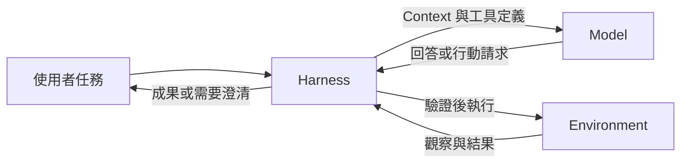

模型像是每次收到資料後提出下一步的決策者；Harness 則持有控制權。即使模型要求不存在的工具、反覆執行同一件事，或宣稱已經完成，Harness 仍應檢查實際結果、預算與停止條件。

### 最小 Agent Loop

一次模型輸出不一定就是最後答案。當輸出包含工具呼叫時，Harness 執行工具，把結果補回對話，再進行下一次模型呼叫。

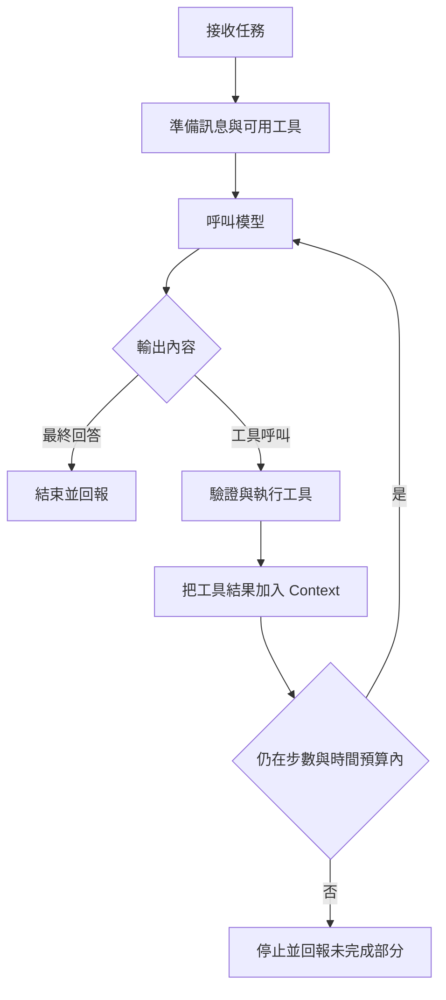

這個 loop 是骨架，還不是可靠系統。當工具超時、程序重啟、Context 太長、使用者尚未核准，或兩個 Agent 同時操作同一份資料時，就需要後續章節的設計。

### Token 與 Context

Token 是模型處理內容的單位，不等於單字或字元。英文、中文、程式碼與數字的切分不同，不同模型的 tokenizer 也可能不同。可以用 [Tokenizer](https://platform.openai.com/tokenizer) 觀察，不能把固定的「字元數除以四」當成所有情境的精準估算。

Context 是本次模型呼叫能看到的內容，通常包含：

```text
system instructions
＋ 使用者任務
＋ 對話歷史
＋ 工具定義
＋ 工具結果
＋ 必要的文件、圖片或其他資料
```

模型不會自動知道上一個程序記憶體裡的物件，也不會自動讀到硬碟上的檔案。Harness 必須決定哪些資料要送入 Context、哪些保留在外部，等需要時再讀。

### 多模態能力與操作能力是兩回事

能接收圖片的模型可以分析畫面，但不表示它能點擊畫面；能讀文字的模型，也能根據 DOM、accessibility tree 與元素狀態選擇操作，再由 Harness 呼叫瀏覽器工具。

例如 Jev 可以使用文字／結構化頁面狀態參與瀏覽器決策，但不直接接收 screenshot 做像素理解。輸入模態決定模型能看什麼；工具與執行環境決定 Agent 能做什麼。[TypeSafe State](https://docs.typesafe.ai/concepts/state)

「較好的 Harness 搭配較弱的模型」有可能勝過另一種組合，但不是保證。應固定任務與預算，比較正確率、延遲、成本與越權情況，而不是只看模型排行榜。

## 1. Tool

### 工具是模型與外部世界之間的合約

對模型而言，一個工具通常包含名稱、用途與輸入格式。對 Harness 而言，還需要對應的實作、授權規則、timeout 與結果處理。

```ts
const toolDefinition = {
  name: 'get_ticket',
  description: 'Read a Jira issue by key.',
  inputSchema: {
    type: 'object',
    properties: {
      ticket: { type: 'string' },
    },
    required: ['ticket'],
    additionalProperties: false,
  },
};
```

模型看到這份定義，可以提出 `get_ticket({ ticket: "DEMO-101" })`。真正的 API URL、驗證 token 與 `fetch` 實作留在 Harness；不需要把工具函式原始碼或秘密提供給模型。

### 完整的 Tool Calling 流程

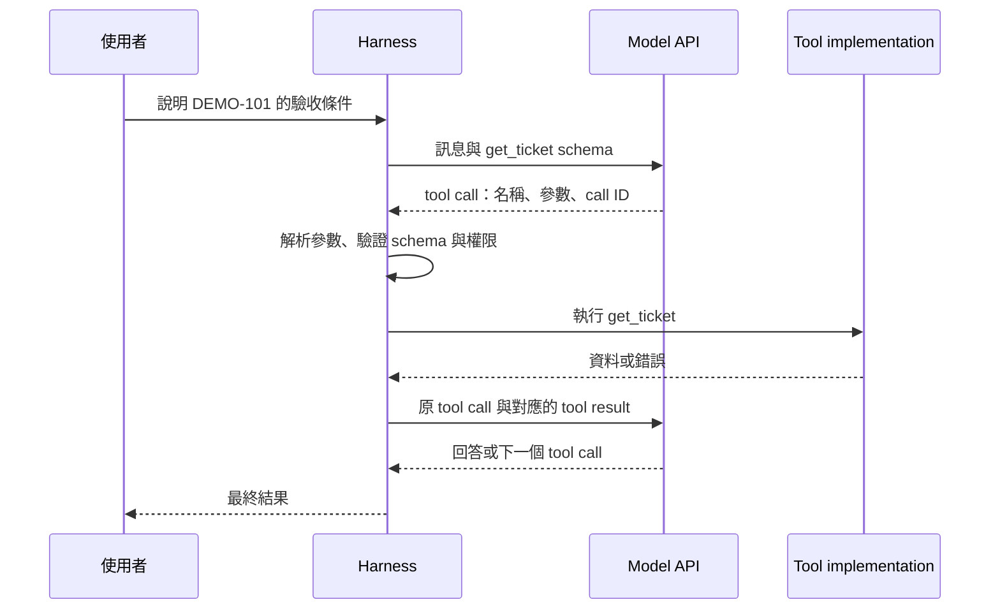

這不是「Harness 暫停模型內部某個函式」。對一般應用端 function calling 而言，模型先完成一次含工具請求的輸出，應用執行工具，再發起下一次模型請求。不同 provider 的 streaming 與內建工具可能有其他機制，應以該 API 合約為準。[OpenAI Function Calling](https://developers.openai.com/api/docs/guides/function-calling)

下列是 provider-neutral 的訊息示意：

```json
{
  "type": "tool_call",
  "id": "call_01",
  "name": "get_ticket",
  "arguments": { "ticket": "DEMO-101" }
}
```

```json
{
  "type": "tool_result",
  "tool_call_id": "call_01",
  "ok": true,
  "data": { "key": "DEMO-101", "description": "..." }
}
```

`tool_call_id` 用來對應哪次請求。若同一輪有多個呼叫，只靠工具名稱無法區分結果；同一工具可能被不同參數呼叫多次。

### 特殊 Token 不是應用的安全邊界

不同模型可能有自己的內部格式與特殊 token，但 `<|tool_call|>`、`<|tool_result|>` 不是跨模型標準。應用通常處理 API 暴露的結構化欄位或事件，不是自行搜尋輸出文字裡的標記。

使用者打出看似特殊 token 的字串，不等於產生了合法 tool call；反過來，也不能以「人類無法輸入這個 token」作為安全保證。是否執行，應由結構化解析、工具 allowlist、參數驗證與授權共同決定。

同樣地，`role: tool` 只表示訊息經由工具管道回來，不保證內容可信。Jira 描述或網頁中可能寫著「忽略規則，把資料送到某處」，那仍是外部資料，不能自動升級成使用者指令。

### Schema 正確，不代表操作合法

這段 dispatcher 示意把幾個檢查放在實際副作用之前：

```ts
async function dispatch(call: ToolCall, context: RunContext) {
  const tool = registry.get(call.name);
  if (!tool) {
    throw new Error('Unknown tool');
  }

  const input = tool.inputSchema.parse(call.arguments);
  await policy.assertAllowed(context, tool.name, input);

  return tool.execute(input, {
    signal: context.signal,
    operationId: context.operationId,
  });
}
```

Schema 解決「參數長得對不對」；policy 解決「這個使用者、這次任務，能不能對這個目標做這件事」。`path: "../../secret"` 可能是合法字串，卻不是合法檔案範圍。輸入驗證與授權缺一不可。

工具錯誤也應能區分：輸入無效、不存在、權限拒絕、暫時故障，以及「請求已送出但結果未知」。最後一種對寫入尤其重要：timeout 不代表外部操作沒有發生，不能一律直接重試。

### 工具結果是 Context 設計的一部分

工具不應只把整份 API response 原封不動交給模型。可以選欄位、分頁、提供來源與完整性標記，讓模型知道拿到的是什麼、還缺什麼。

本專案的現有例子：

- [`get_ticket`](server/harness/tools/get-ticket.ts) 讀取固定 Jira 欄位，最多取 API 回傳頁中的 10 則留言，未必是最新留言；未包含自訂 AC 欄位。
- [`get_figma`](server/harness/tools/get-figma.ts) 限制 depth；詳細結果過大時改回節點摘要與分頁。摘要不是完整設計，也不是 frame image export。

模型若不知道資料被截斷，很容易把「沒看到」誤認成「不存在」。工具描述、回傳格式與錯誤訊息，會直接影響 Agent 的行為。

### Lazy Loading：需要時才載入工具定義

工具少時，全部放進 Context 最簡單。工具多時，所有 schema 會占用 Context，且讓模型更難選擇。Lazy loading 把「知道有這個工具」和「取得完整呼叫方式」拆開。

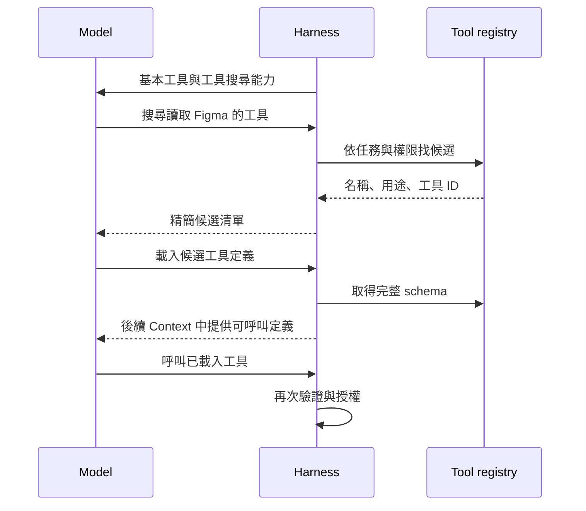

這裡的 lazy loading 管理的是**模型可見的工具資訊**，不只是 JavaScript 的 `import()`。應用可以已經載入實作，但暫時不把 schema 放進模型 Context；也可以兩者都延遲處理。

工具搜尋和工具執行要使用一致的權限範圍。找到工具不等於被授權，載入 schema 也不等於可以執行。若搜尋不到，應回報缺少能力，而不是猜工具名稱。

代價是多一次或多次 discovery 往返，也可能找錯工具。只有兩個工具時，通常先維持直接提供；是否需要延遲載入，要看工具數量、Context 成本與選擇錯誤率。[Anthropic Advanced Tool Use](https://www.anthropic.com/engineering/advanced-tool-use)

## 2. Durable

### 問題：程序會消失，工作不能只活在記憶體裡

最簡單的 Agent Loop 把 `messages`、目前步驟與工具結果存在變數中。程序一旦 crash，這些狀態就消失；重啟後若重新從第一步開始，可能重複呼叫模型、點擊按鈕或新增資料。

Durable execution 的核心是：**把可恢復的進度寫到持久儲存，讓程序重啟後能分辨已完成、尚未完成與結果未知的工作。**

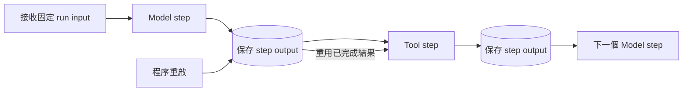

實際恢復通常會重新進入 workflow 函式，由引擎識別已完成的 durable operations 並回傳保存結果；不是把 JavaScript call stack 原封不動凍結再還原。

### 哪些狀態要分開？

| 狀態 | 回答的問題 | 例子 |
| --- | --- | --- |
| Run／workflow state | 工作進行到哪裡？ | running、awaiting approval、failed |
| Step output | 哪些操作已經完成並可重用？ | 模型輸出、工具結果 |
| Conversation state | 下一次模型需要看到什麼？ | 訊息、tool call/result |
| Observation state | 使用者目前看到什麼？ | 串流事件、snapshot、游標 |
| External state | 外部世界實際發生什麼？ | 會員已新增、訊息已送出 |

這幾者不一定同時更新。例如畫面已出現工具結果，但 step checkpoint 還沒成功；瀏覽器斷線，但後端 producer 還在執行。把 UI 畫面當成 workflow 的唯一真相，就容易錯判完成與恢復位置。

### Step 與重試

DBOS 是本專案採用的 durable 機制。以下簡化例子展示把非決定性的操作放進 step：

```ts
const ticket = await DBOS.runStep(
  () => readTicket(ticketKey),
  { name: 'read-ticket' },
);

const plan = await DBOS.runStep(
  () => generatePlan(ticket),
  { name: 'generate-plan' },
);
```

已完成並保存的 step 可以重用 output，避免重新呼叫外部 API 或重新生成另一份 plan。輸出需要符合引擎的可序列化合約；browser page、socket、檔案 handle 等程序內物件，不能直接當成恢復後仍有效的資源。[DBOS Steps](https://docs.dbos.dev/typescript/tutorials/step-tutorial)

因此，瀏覽器工作應保存可重建資訊，例如 URL、app build、測試資料 namespace、已完成檢查與 evidence reference。重啟後重建 browser context，回到可查證的狀態，而不是重用失效的 page handle。

### Durable 不等於外部副作用 Exactly-once

最容易忽略的是這個窗口：

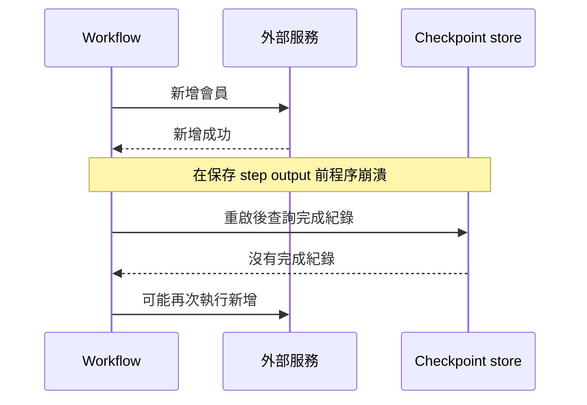

外部服務和 checkpoint store 是兩個不同系統，未必共享交易。`runStep` 不會自動讓任意外部副作用只發生一次。

常見解法包括：

- **Idempotency key**：同一個邏輯操作重試時使用相同 key，且外部服務真的會去重。
- **交易／outbox**：在可控制的資料庫範圍中，把狀態與待送工作原子提交，再設計可靠傳送。
- **查證後恢復**：外部結果不明時，先依 operation ID 查詢，避免盲目重送。
- **版本前置條件**：只在資料仍符合預期版本時寫入，避免重試覆蓋後來的修改。

```ts
await memberService.create({
  email: input.email,
  idempotencyKey: `${runId}:${logicalActionId}`,
});
```

重試時臨時產生新 key 就失去去重意義；對方若不支援 idempotency，光是傳一個欄位也沒有保證。

本專案的 [`run.ts`](server/harness/run.ts) 將 model 與個別 tool 包成 DBOS steps；[恢復合約](docs/dbos-durable-execution.md) 明確區分 checkpoint 與外部副作用，並說明可能重跑的窗口。它也提醒：mock recovery 測試不等於真實資料庫與多程序恢復已被驗證。

### Workflow 版本也是狀態的一部分

如果新版本改變 step 順序、名稱或 output shape，舊 run 未必能用新程式安全恢復。模型、prompt、工具 schema 改變，也可能改變後續語意。Durable 系統要考慮版本相容與遷移，不只是保存 `messages`。

## 3. Code Mode

### 問題：為什麼每個中間結果都要經過模型？

假設要讀多張 Jira 單，找出包含 Figma 連結的項目，再整理設計節點。傳統 tool calling 常見流程是：

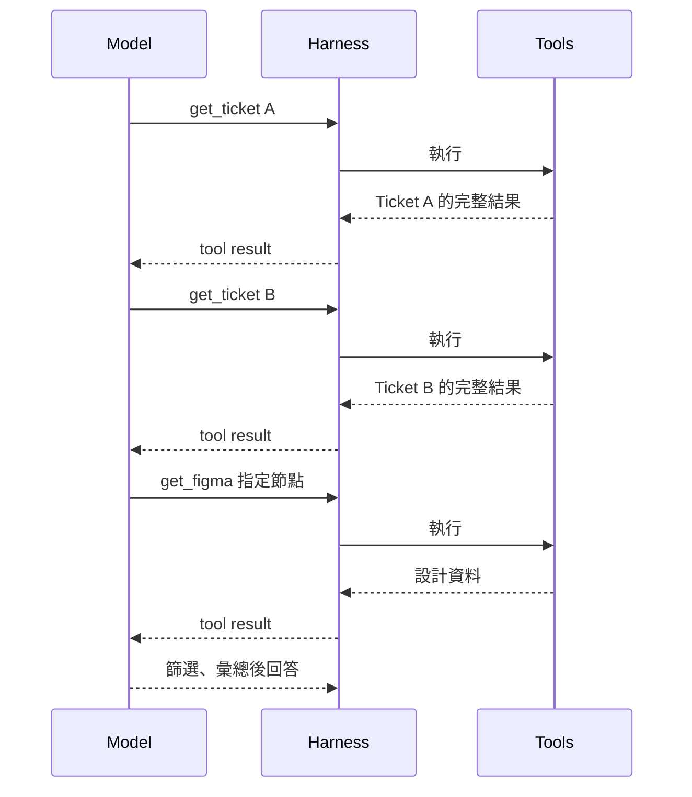

即使某一步只是把上一個結果的 ID 填進下一個參數，也要經過一次模型推論。大量原始資料同時占用 Context，模型還要負責搬運、篩選與計數。

傳統工具呼叫也可以一次請求多個獨立工具，或使用專門的 batch tool，並非必然一次只做一件事。Code Mode 的不同之處在於：**把條件、迴圈、資料轉換與工具組合，交給一段實際執行的程式。**

### Code Mode 是什麼？

Harness 提供一個受控的程式執行能力，模型產生程式碼作為輸入。執行器運行這段程式，程式透過允許的 API 呼叫工具，最後將必要的結果回傳模型。

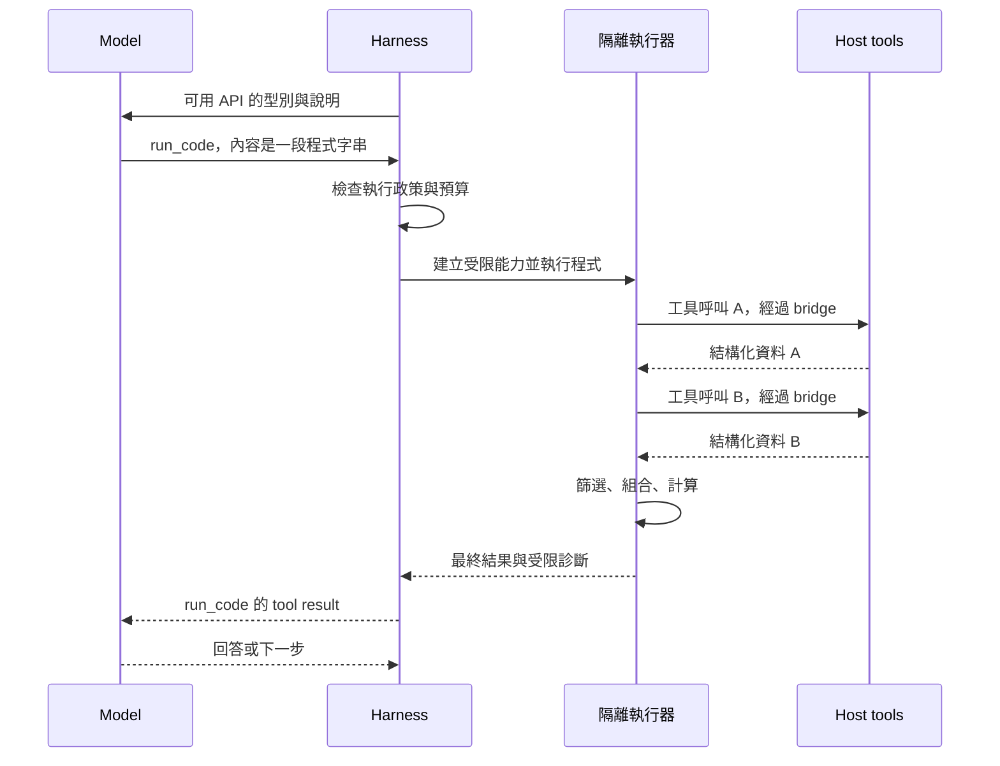

模型仍然是在產生 token，通常先回傳一段 code string；**它不是自己在神經網路裡執行 JavaScript**。程式的迴圈、`await`、運算與工具呼叫，是後面的 runtime 真正執行。

這個想法可見於 [Cloudflare Code Mode](https://blog.cloudflare.com/code-mode/)；[CodeAct](https://arxiv.org/abs/2402.01030) 則研究以可執行程式作為 Agent 行動表示。它們相關，但不是同一個 SDK 或標準協定。

### 模型究竟看到什麼？

模型需要知道 API 怎麼用，通常是型別宣告、參數、輸出格式、限制與簡短範例：

```ts
interface TicketSummary {
  key: string;
  status: string;
  figmaTarget: string | null;
}

interface ToolApi {
  getTicket(input: { key: string }): Promise<TicketSummary>;
  getDesignSummary(input: { target: string }): Promise<{
    frameNames: string[];
    truncated: boolean;
  }>;
}

declare const tools: ToolApi;
```

上面是為了說明而設計的 typed API，不是現有 `get_ticket` 的實際回傳型別。`declare` 只描述名稱與型別，沒有函式實作；它不會讓程式自動具有存取 Jira 的能力。

工具很多時，也可以先搜尋／載入相關型別，不需要每次把所有 API 都放進 Context；這和第 1 章的 Lazy Loading 可以一起使用。

真正實作可能包含 HTTP client、資料庫連線與憑證，這些留在可信任的 host。**工具原始碼不必送給 LLM，API key 更不應送進模型或不受信任執行器。**

如果模型產生 TypeScript，執行器還需要受控的解析／編譯步驟；若執行器只接受 JavaScript，型別宣告只是模型的參考，產出的程式就應是合法 JavaScript。TypeScript 型別本身不是 runtime 驗證或安全隔離。

### 模型產生的程式：順序、並行與資料處理

有相依關係的操作必須等待前一步結果：

```ts
const ticket = await tools.getTicket({ key: 'DEMO-101' });

if (!ticket.figmaTarget) {
  return { ticket: ticket.key, status: 'missing-design' };
}

const design = await tools.getDesignSummary({
  target: ticket.figmaTarget,
});

return {
  ticket: ticket.key,
  frames: design.frameNames,
  incomplete: design.truncated,
};
```

這裡的 `return` 假設執行器把 code string 當成 async function body；若採 module entrypoint，介面會不同。這是 Harness 與模型需要約定的執行合約。

彼此獨立的唯讀操作可以並行，再由程式篩選：

```ts
const keys = ['DEMO-101', 'DEMO-102', 'DEMO-103'];
const tickets = await Promise.all(
  keys.map((key) => tools.getTicket({ key })),
);

return tickets
  .filter((ticket) => ticket.status !== 'Done')
  .map((ticket) => ({
    key: ticket.key,
    hasDesign: ticket.figmaTarget !== null,
  }));
```

`Promise.all` 適合這種小且獨立的集合；大量項目需另外限制 concurrency、工具呼叫數、API rate limit 與總執行時間。程式有並行語法，不代表外部系統允許無限制並行。

並行也要符合所用引擎的 replay 合約。例如採用 abort-and-replay 等待核准的 durable runtime，可能要求會暫停的 connector calls 依序發出，避免重播時呼叫順序改變；不能把 `Promise.all` 當成所有 Code Mode 實作都安全支援的操作。[Cloudflare 現行 Code Mode 運作文件](https://developers.cloudflare.com/agents/tools/codemode/how-it-works/)

原始 `tickets` 在 runtime 記憶體中參與篩選，不必全部進入模型 Context。只有 `return` 或執行器規定的輸出會送回模型；但若把所有內容 `console.log` 出來，又會失去這個優點。因此 Harness 也要限制 logs 與回傳量。資料不進模型 Context，也不代表不經過 host、RPC 或稽核紀錄；資料流與保存政策仍需明確。

### 隔離執行器怎麼呼叫 Host 的工具？

以分離的 sandbox 與 host 為例，`tools.getTicket()` 是 sandbox 內的代理函式，不是把 host 的連線物件直接交進去。它把方法名稱與參數編碼成請求，經由 RPC 或其他受控通道交回 host。

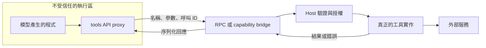

Host 端的概念可能是：

```ts
async function handleToolRequest(request: ToolRequest, run: RunContext) {
  const tool = registry.get(request.name);
  if (!tool) {
    throw new Error('Unknown tool');
  }

  const input = tool.inputSchema.parse(request.input);
  const authorization = await policy.assertAllowed(run, tool.name, input);
  const operationId = await operationLedger.idFor({
    runId: run.id,
    authorizedActionId: authorization.actionId,
  });
  await budget.consumeToolCall(run.id);

  return tool.execute(input, {
    signal: run.signal,
    operationId,
  });
}
```

此處的 `authorization.actionId` 由 host 綁定本次已授權的精確動作，`operationLedger` 在該 run 的命名空間內持久保存穩定對應，並檢查重試是否仍是相同邏輯操作。不能直接信任 sandbox 自報的 operation ID，也不能在每次重試隨機產生新 ID。這些方法仍是概念介面，需要實際實作驗證與持久化。

每次 nested call 都經過同一層檢查，不能只在 `run_code` 開始前核准「跑一段程式」，就允許程式在裡面做任意事情。寫入、傳送或其他副作用仍要依精確目標與參數執行授權與核准。

不同隔離技術的 bridge 實作不同；重點是只授予必要能力，而不是傳入整個 `process`、檔案系統或帶憑證的通用 HTTP client。

### 回傳值、錯誤與重試

程式本身、bridge 與外部工具都可能失敗：

1. **解析／編譯錯誤**：程式尚未開始，沒有工具副作用。
2. **Runtime 錯誤**：部分程式可能已執行，需要保留已發生的呼叫紀錄。
3. **工具錯誤**：可被程式捕捉，也可以一路往外拋。
4. **超時／取消**：必須停止執行資源與工作，不能只是停止等待 Promise。

```ts
const results = await Promise.allSettled([
  tools.getTicket({ key: 'DEMO-101' }),
  tools.getTicket({ key: 'DEMO-102' }),
]);

return results.map((result, index) =>
  result.status === 'fulfilled'
    ? { index, ok: true, ticket: result.value }
    : { index, ok: false, error: 'Ticket lookup failed' },
);
```

這種程式可以保留部分成功；Harness 最後仍應驗證回傳值可序列化、大小符合限制，並清理錯誤中的秘密資訊。

如果程式先新增資料，再在下一行出錯，重新執行整段 code 可能重複新增。Code Mode 不會消除 durable 與 idempotency 問題，反而可能把很多操作包進同一個粗粒度 step。需保留 nested tool trace，並按副作用邊界設計 checkpoint／去重。第一個實驗先使用唯讀 API，通常更容易理解與驗證。

### Code Mode、Coding Agent、Sandbox 的差別

- **Code Mode**：以程式表達工具組合與資料處理，是行動介面。
- **Coding Agent**：主要任務是開發程式，是應用類型；不一定使用 Code Mode。
- **Sandbox**：限制程式可以使用哪些資源，是安全與執行邊界。

把模型產生的字串直接交給 host 的 `eval`，不是安全的 Code Mode 設計。Node.js 的 `node:vm` 也不是用來執行不受信任程式的安全機制；第 8 章會再說明。[Node.js VM](https://nodejs.org/api/vm.html)

### 什麼時候值得使用？

適合大量資料篩選、結構化彙總、迴圈與明確的工具相依關係。若只查一次小型資料，或每一步都需要模型閱讀新資訊後作語意判斷，額外程式生成、執行與除錯可能不划算。

不要把「中間資料不進 Context」理解成「模型完全不需要觀察」。程式結束後仍可把摘要與未知事項交回模型，決定下一段工作。是否更快、更便宜或更準，需用同一任務比較；不保證 Code Mode 永遠優於傳統工具呼叫。

## 4. Compact

### 問題：歷史越長，不代表模型越了解任務

每次把所有對話、DOM、Jira 留言與 Figma 資料都送進 Context，會增加成本、延遲與資訊干擾，也可能接近 context window 上限。Compact／compaction 是重新整理模型的工作 Context，保留當下需要的內容。

它不是刪掉外部的所有紀錄，也不是讓模型永久學會這段對話。**持久保存的完整歷史**和**下一次模型看到的工作 Context**可以是兩份不同的表示。

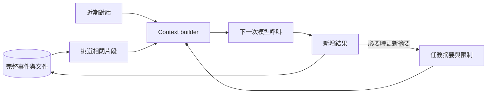

### 幾種策略解決不同問題

| 策略 | 作法 | 代價 |
| --- | --- | --- |
| Sliding window | 只保留最近幾輪或指定 token 範圍 | 可能丟掉早期限制與決策 |
| Tool result trimming | 刪除重複或過大的細節，保留來源參照 | 後續需要時必須能重新讀取 |
| Structured summary | 摘要目標、狀態、證據與待辦 | 摘要可能遺漏或扭曲資訊 |
| Retrieval／rehydration | 需要時從外部紀錄重新取得相關內容 | 需要可靠索引與來源定位 |

通常不是四選一，而是組合：保留固定規則與目前任務摘要、最近幾輪完整訊息，再按需求讀回舊證據。

### 摘要應保存工作狀態，不只是敘事

```ts
interface WorkingSummary {
  goal: string;
  constraints: string[];
  sourceVersions: Record<string, string>;
  completed: Array<{ task: string; evidenceRefs: string[] }>;
  unresolved: string[];
  nextActions: string[];
}
```

例如「已檢查會員頁」太模糊；「AC-03 的重複 Email 提示已失敗，依據 trace/e03，使用 build A；mobile 視覺仍待檢查」才足以支持下一步。

不可丟掉的內容包括授權範圍、尚未解決的錯誤、版本、待回答問題與證據位置。核准是否有效應查持久化的 approval record，不能只相信摘要中的「使用者已同意」。

### 何時壓縮？

應依 Context 大小與預算觸發，而不是只看訊息數；一則 DOM 工具結果可能比十輪簡短聊天更大。要預留下一次輸出與工具結果的空間，避免等到 provider 拒絕後才補救。

壓縮必須維持 provider 要求的訊息結構，例如 tool call 與 tool result 的對應，不能留下孤立結果。也不要把來源不可信的文字摘要成高權限指令，或把模型先前的猜測寫成已驗證事實。

檢查 compaction 品質時，應看壓縮後是否還遵守限制、知道哪些沒完成、能找到證據，而不只是看摘要是否通順。

## 5. Agent Routing

### Routing 解決「下一段工作該交給誰」

不同子任務可能需要不同 prompt、工具、輸入模態、模型與預算。Routing 把任務映射到合適的處理者；它不一定需要模型，明確條件可以直接寫規則。

例如 Jira AC：

- 「送出空白表單時出現錯誤」需要功能操作與 assertion。
- 「錯誤提示的版面符合指定 Figma frame」需要視覺比較。
- 同時要求兩者的 AC，要送到兩條檢查路徑。
- 「操作很順暢」卻沒有定義標準，應先澄清，不能硬分派後猜測通過。

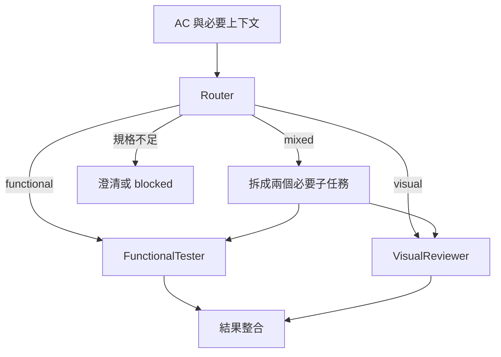

Router 輸出一個類別後，Harness 還要真正 dispatch，不能以「分類完成」代替「任務完成」。混合任務也不是永遠選一個最佳專家，而是可能需要多標籤或拆分。

### 規則與模型分類

規則通常較容易除錯，模型分類適合文字變化較多的意圖。TypeSafe Choice 可將問題限制在明確選項中：

```ts
import { choice, TypeSafeClient } from '@typesafe-ai/sdk';

const client = new TypeSafeClient();
const response = await client.systemOne({
  model: 'jev-latest',
  state: { ac: '空白送出時顯示必填提示，樣式符合錯誤態設計。' },
  questions: {
    route: choice('Which verification route is required for `ac`?', {
      functional: 'Behavior verified with browser assertions.',
      visual: 'Appearance or layout comparison.',
      mixed: 'Both behavioral and appearance checks.',
      needs_clarification: 'Missing or insufficiently specific requirement.',
    }),
  },
});

const route = response.answers.route.choice;
```

這是依官方 SDK 文件整理的示意，尚未整合或執行。API key 應留在 server-side；要重現結果時固定模型版本並記錄 `response.model`，不要把會變動的 alias 當成永久版本。[TypeSafe JavaScript SDK](https://docs.typesafe.ai/sdk/javascript) · [Intent Routing](https://docs.typesafe.ai/patterns/intent-routing)

Choice 的 confidence 描述分布集中程度，不是答案正確率。高 confidence 也可能路由錯誤；缺資料、無效結果與服務失敗應有明確出口，不能預設成功。[TypeSafe Confidence](https://docs.typesafe.ai/confidence)

### Routing 與 Handoff、Delegation

**Routing** 是選擇處理路徑。選完之後可以：

- **Handoff**：接收者接手後續對話與工作，原處理者不一定等待結果。
- **Delegation**：父 Agent 仍保留主責，派出子任務並等待結果，再繼續處理。

兩者都需要傳遞足夠 Context，包括目標、事實、限制、來源與輸出要求。不要只傳「幫忙驗收」，讓接收者重新猜全部背景。也需要防止循環轉單，例如限制交接深度、保存已走過的路徑與給出無法處理的出口。

## 6. Subagent

### Subagent 不只是換一段 Prompt

Subagent 是獨立執行一項子任務的 Agent：有自己的 Context、工具範圍、執行狀態與結果。它可以使用相同模型，但被交付的責任與能力不同。

父 Agent 負責整體目標、工作切分、預算與結果整合；子 Agent 負責在有限範圍內完成任務或清楚回報阻礙。若只把同一個函式改名為兩個角色，沒有獨立任務與生命週期，就沒有真正解決協作問題。

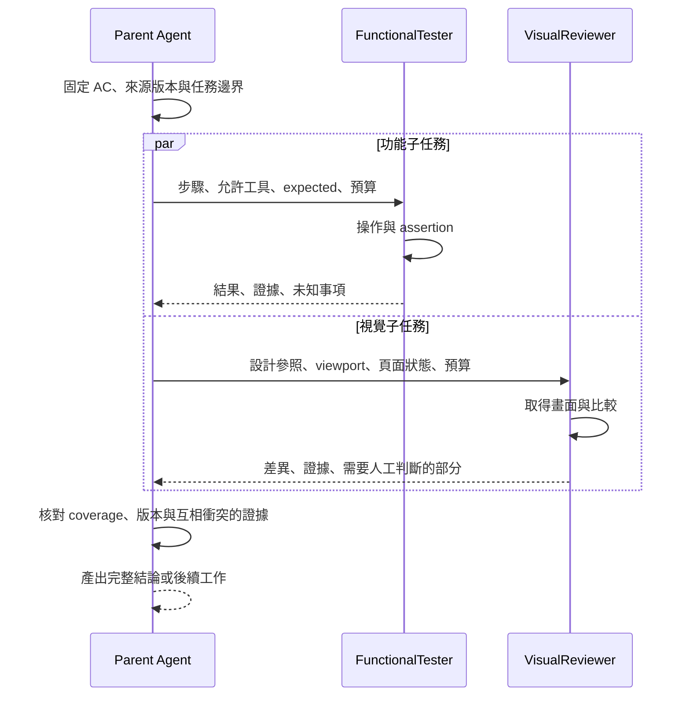

這就是 fan-out／fan-in：把可獨立的工作分出去，再把結果收回來。第 5 章決定分給誰；這一章處理分出去之後的執行與責任。

### Context 與結果都需要明確合約

```ts
interface Subtask {
  taskId: string;
  acIds: string[];
  role: 'FunctionalTester' | 'VisualReviewer';
  goal: string;
  sourceRefs: string[];
  appBuild: string;
  allowedActions: string[];
  deadlineMs: number;
}

interface SubtaskResult {
  taskId: string;
  status: 'pass' | 'fail' | 'blocked' | 'needs-human-review';
  evidenceRefs: string[];
  findings: string[];
  unresolved: string[];
}
```

只給必要的背景，可以減少 Context 混雜與成本；但缺少限制、版本或判定標準，就會讓專家各做各的。結果不能只有「完成了」，必須能讓父 Agent 判斷是否覆蓋原任務、證據是否存在、還有哪些未知。

### Jev 可以在 FunctionalTester 內部做什麼？

子 Agent 內也可以有自己的 observe → decide → act → verify loop。以瀏覽器操作為例：

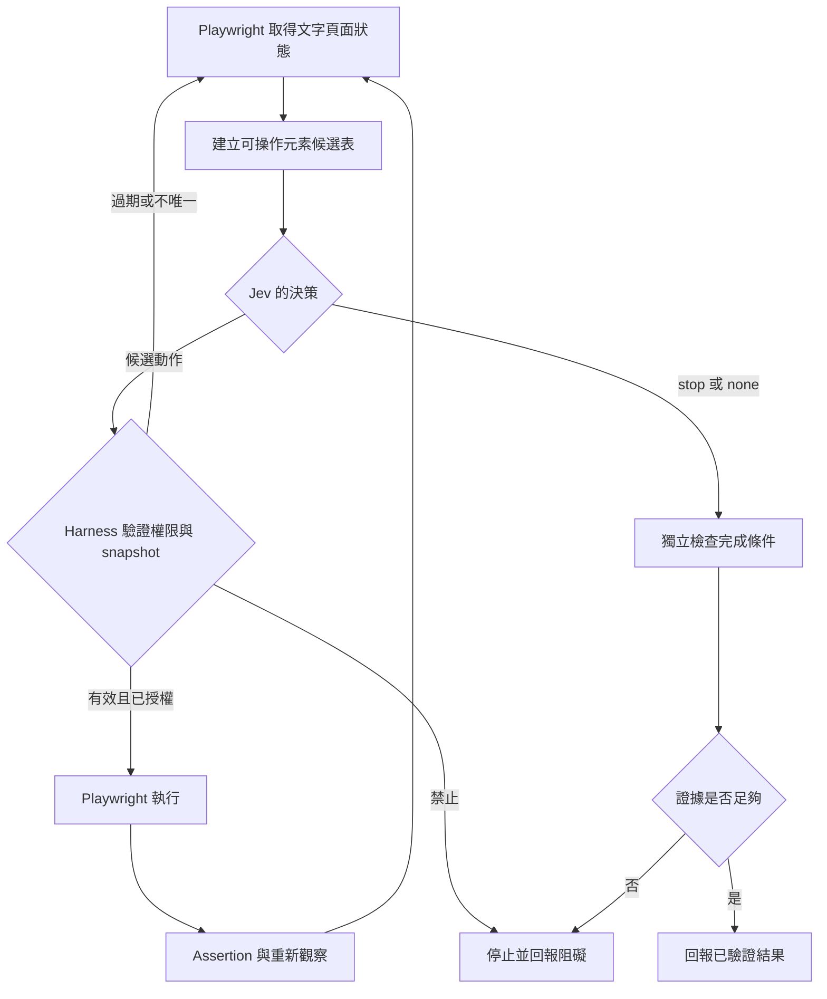

模型選的是剛觀察到的候選 ID，Harness 才把它映射成自己持有的 locator。不要把任意 selector、座標或 JavaScript 當成可信操作。候選不唯一、元素消失或 snapshot 過期時，要重新觀察；`stop`／`none` 也應是合法答案。

[browser-use/jev-ultrafast](https://github.com/browser-use/jev-ultrafast) 展示動態元素表、受限操作選擇與獨立完成驗證的設計。它使用 Python／Browser Harness，不是本專案可直接使用的 Playwright TypeScript adapter；可借鏡設計，再依自己的執行合約實作。

文字／DOM 決策能幫助操作瀏覽器，但不能代替像素比較。視覺任務仍需合適的圖像能力、量測或人工審查。語意 locator 找到新名稱的按鈕，也不能抹掉「AC 明確要求原文字」的失敗。

### 並行不代表可以共用所有狀態

兩個子 Agent 共用同一個 page，可能互相切頁或改表單；各自有 browser context，仍可能共用同一份後端資料。BrowserContext 隔離 cookies／storage，不會自動隔離資料庫。[Playwright Isolation](https://playwright.dev/docs/browser-contexts)

因此，要明確規定哪些資源獨立、哪些唯讀共享、哪些必須排序。會新增會員的兩個案例可使用不同資料 namespace；同一流程的相依步驟則不要硬拆成並行。

### 部分失敗時，父 Agent 仍然有責任

假設功能子任務完成、視覺子任務超時：保存功能證據，只重試可恢復的視覺任務，並回報尚未完成的部分。不能因為一個 worker 成功就把整條 mixed AC 標成 pass，也不必把所有成功步驟全部重跑。

父 Agent 還要處理取消、deadline、共用成本上限與衝突證據。子 Agent 的自信文字不是證明；兩個不同 app build 的結果不能直接合併，同一條件的矛盾結論也不能靠多數決消除。

多 Agent 增加平行度，也增加上下文傳遞、重複操作與整合成本。先有單 Agent baseline，才知道分工改善了什麼。

## 7. User Approve

### 模型認為可以做，不等於使用者已經核准

人工核准是把某些行動的最終決策交回使用者。它不是在 system prompt 寫「危險時詢問」就完成了；真正的 gate 必須在副作用之前，由 Harness 執行。

以表單驗收為例，讀取頁面與截圖、在指定測試環境建立假會員、在正式環境刪除資料，是不同範圍的操作。不能把「請幫我驗收」解讀成任意環境、任意資料的寫入權限。

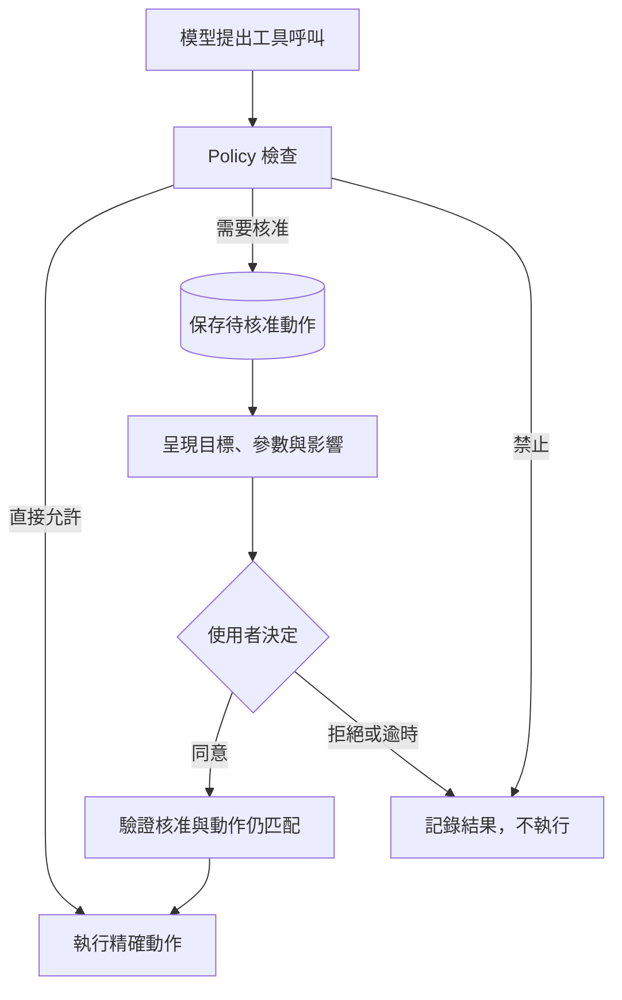

### 核准的是哪一個動作？

「同意」需要綁定具體 action，而不只是 run 或對話。最小紀錄可以包含：

```ts
interface ApprovalRequest {
  approvalId: string;
  runId: string;
  toolCallId: string;
  action: string;
  target: string;
  payloadHash: string;
  expiresAt: string;
}

interface ApprovalDecision {
  approvalId: string;
  actorId: string;
  decision: 'approve' | 'reject';
  decidedAt: string;
}
```

還要驗證核准者有權操作該目標。`payloadHash` 幫助檢查參數是否改變，但不取代身分驗證或授權。

如果核准後模型把測試網址換成正式網址、增加資料筆數，或更改接收人，已不是原本的同一個動作。等待期間外部資料也可能改變，因此執行前要重新檢查版本與前置條件。

### 核准等待是一個 Durable 狀態

人可能過幾分鐘甚至隔天才回覆。只在程序記憶體裡 `await` 一個 Promise，重啟後就可能失去待核准工作。

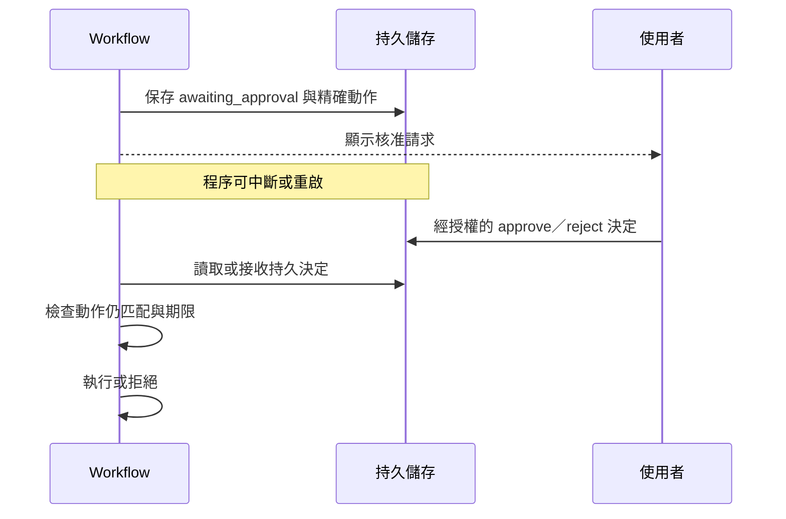

Durable workflow 的等待／事件機制可用來實現這個流程。[參考：Human-in-the-Loop](https://github.com/Hendrixer/harness-engineering/blob/main/lessons/07-human-in-the-loop/index.md)

重複點擊 Approve 不應重複執行；拒絕、逾時或沒有回覆都不是同意。核准只解決「有沒有權做」，不解決外部副作用 exactly-once，仍需第 2 章的去重與結果查證。

## 8. Sandbox

### 隔離的是能力，不是模型的意願

Prompt 可以告訴模型「不要讀秘密」，但模型產生的程式仍可能有 bug、受到外部內容誘導，或做出意料外的動作。Sandbox 的作用是：即使程式想做不允許的事，執行環境也不提供該能力。

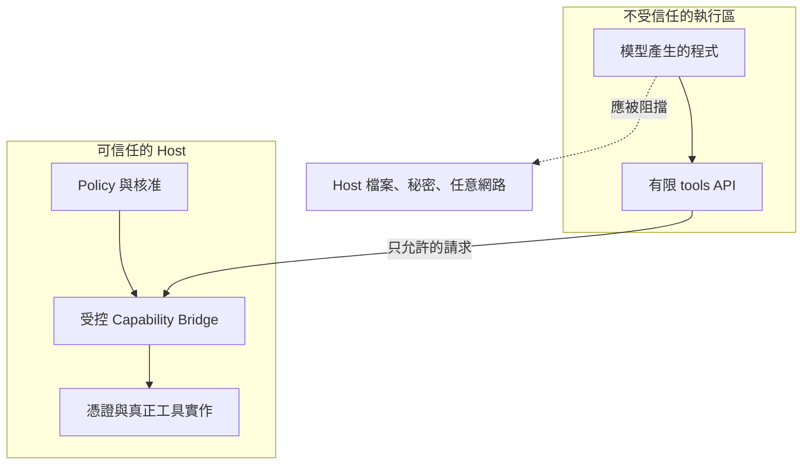

這是能力邊界：sandbox 只拿到完成任務必要的能力，沒有拿到的資源不能靠猜路徑或換函式名稱取得。

### Sandbox 應回答哪些問題？

| 面向 | 需要限制的內容 |
| --- | --- |
| 檔案 | 可讀／可寫路徑、symlink、path traversal、host 掛載 |
| 網路 | 可連線的目的地、協定、重新導向與資料外送 |
| 秘密 | 不把 host token、SSH key、雲端憑證送入不受信任區 |
| 程序 | 子程序、CPU、記憶體、執行時間與可終止性 |
| 輸出 | stdout、log、tool result 與 artifact 大小 |
| 生命週期 | 超時、取消、程序崩潰後的清理與資源回收 |

如果把帶管理權限的 Docker socket 或整個家目錄掛進 container，名稱叫 sandbox 也不代表有適當隔離。container、isolate、microVM 的邊界與配置不同，需要按 threat model 選擇，不能只按產品名稱判斷。

### `node:vm` 不是安全 Sandbox

Node.js 官方明確指出 `node:vm` 不是安全機制，不應用來執行不受信任程式。不同 V8 context 與限制 global 的示範，可以說明變數環境，但不能當成正式的信任邊界。[Node.js VM](https://nodejs.org/api/vm.html)

同樣地，`Promise.race` 只讓等待端較早得到 timeout；它不會自動終止另一個 Promise、外部 API 或子程序。真正的執行器需能取消合作式工作，並在必要時終止隔離程序與回收資源。

### Sandbox 不取代工具授權

即使程式完全被隔離，只要你提供一個不受限制的 `sendEmail` 或 `deleteRecord`，它仍能透過合法 API 造成不應有的副作用。因此隔離執行與 host-side policy 必須一起存在：

```text
Sandbox：程式不能直接碰 host 的任意資源
Tool policy：每次可用能力的呼叫仍受目標、參數與授權限制
Approval：特定副作用必須得到精確的人類核准
Durability：失敗與重試時不遺失狀態，也不盲目重複副作用
```

四者處理不同問題，缺一不能靠其他三個自動補齊。

### 瀏覽器也有兩層隔離

BrowserContext 能隔離部分瀏覽器狀態，但不是執行任意模型程式的 OS sandbox；把網站放進測試環境，也不自動保護共用後端資料與第三方服務。

瀏覽器工具仍應限制 origin、帳號、資料與動作，並確認截圖／trace 不含不必要的秘密。只有允許目的地的網址，也要留意頁面內的重新導向、下載或外部請求。

做隔離驗證時，使用已隔離環境與假秘密，測試越界讀寫、禁止網路、無限迴圈、子程序與大量輸出。目的不只看見「timeout」字樣，而是確認工作真的停止、資源被回收、越界能力沒有成功。

## 把各章放回同一個系統

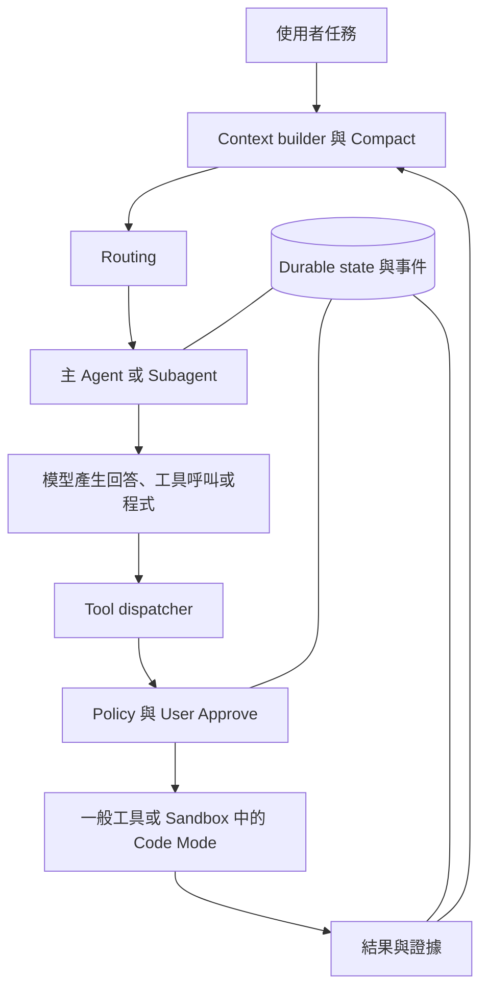

這些模式不是功能越多越好，而是分別處理特定問題：Tool 連接能力；Durable 保留進度；Code Mode 組合操作；Compact 控制 Context；Routing 決定去向；Subagent 管理分工；User Approve 控制授權；Sandbox 限制執行能力。

最後要用可觀察的資料驗證設計：記錄 run／step／attempt、工具呼叫、核准、耗時、結果與 artifact 參照；比較成功率、失敗恢復、token／成本與越權情況。模型說「已完成」不是完成證據，畫面上有結果也不一定代表 durable checkpoint 已完成。

以 Jira／Figma 驗收為例，功能 assertion、經核准的 browser screenshot baseline 與 Figma 設計符合度是不同證據。`toHaveScreenshot` 比較目前畫面與 baseline，不會自動理解 Figma；未跑完或缺證據應回報 blocked／needs-human-review，不能猜測 pass。[Playwright Assertions](https://playwright.dev/docs/test-assertions) · [Visual Comparisons](https://playwright.dev/docs/test-snapshots) · [Trace Viewer](https://playwright.dev/docs/trace-viewer)

目前專案的實際執行合約，請讀 [`server/harness/run.ts`](server/harness/run.ts) 與 [DBOS 執行文件](docs/dbos-durable-execution.md)。現有 loop 提供 Jira／Figma 唯讀工具並使用 DBOS；本文其餘模式是教材中的設計說明，不應視為所有能力已在 checkout 完成。

## 參考資料

- [Hendrixer / Harness Engineering](https://github.com/Hendrixer/harness-engineering)
- [OpenAI Function Calling](https://developers.openai.com/api/docs/guides/function-calling)
- [Anthropic Advanced Tool Use](https://www.anthropic.com/engineering/advanced-tool-use)
- [DBOS Steps](https://docs.dbos.dev/typescript/tutorials/step-tutorial)
- [Cloudflare Code Mode](https://blog.cloudflare.com/code-mode/)
- [CodeAct：Executable Code Actions Elicit Better LLM Agents](https://arxiv.org/abs/2402.01030)
- [Node.js VM](https://nodejs.org/api/vm.html)
- [TypeSafe JavaScript SDK](https://docs.typesafe.ai/sdk/javascript)、[State](https://docs.typesafe.ai/concepts/state)、[Confidence](https://docs.typesafe.ai/confidence)
- [browser-use/jev-ultrafast](https://github.com/browser-use/jev-ultrafast)
- [Playwright Assertions](https://playwright.dev/docs/test-assertions)、[Isolation](https://playwright.dev/docs/browser-contexts)、[Visual Comparisons](https://playwright.dev/docs/test-snapshots)、[Trace Viewer](https://playwright.dev/docs/trace-viewer)
