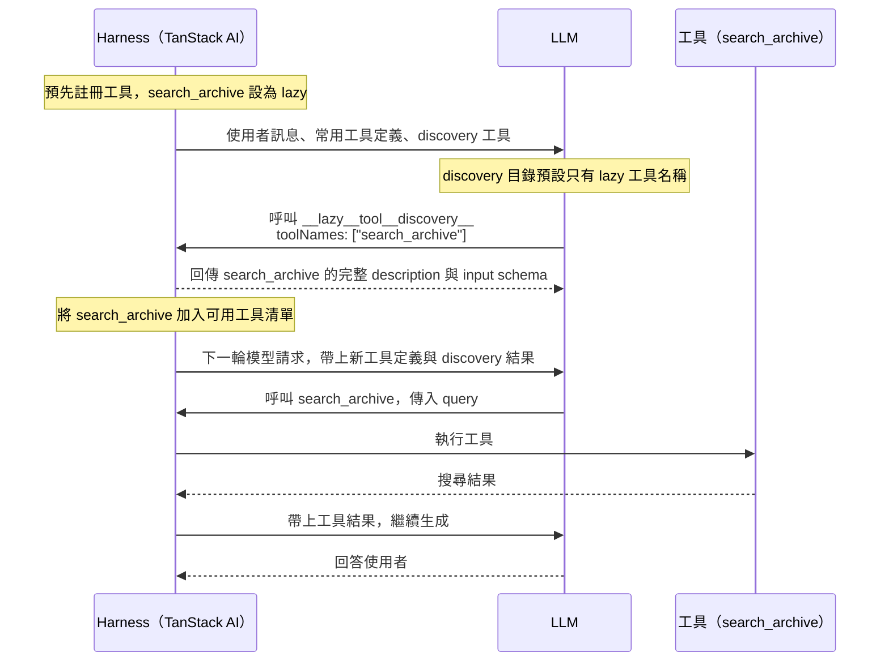
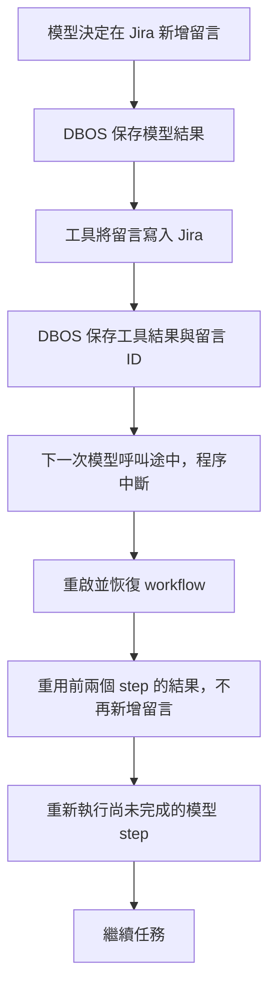

## Before Start

> [!NOTE]
> 此專案為教學用專案，透過 Coding Agent 建立 Harness 的系統，客製化自己的 Workflow。  
> 部分 Code 會使用手動編輯的方式，避免整個方向歪掉。  
> 不限定使用的 Agent 工具，以理解 Harness 觀念為主。  
> 我會使用 [PI](https://pi.dev/) 進行開發，搭配 [pstack](https://github.com/backnotprop/pstack)。

- [skills](https://github.com/tp6gw94/skills)
- [pi](https://github.com/tp6gw94/my-pi)


## 0. Intro

Agent = Model + Harness


好的 Harness 搭配不怎麼樣的模型能力可能大於強大的模型搭配不好的 Harness。

目標：建立會閱讀 Jira 和 Confluence 的 Agent，替我們撰寫 test case，並操作瀏覽器進行真實的測試，記錄下來結果。


## Architecture

Harness 脊柱到 Compact 為止：

```text
Tools（含 lazy MCP） → Durable run（DBOS + Drizzle） → Code Mode → Compaction
```

後續能力若要加，疊在這條脊柱上。不要另起第二套 chat loop。

### 目錄怎麼對應

| 路徑 | 職責 |
|---|---|
| `server/index.ts` | Hono 入口。掛 `/api/chat`、`/api/thread`，啟動與關閉 `launchChatRuntime` / `shutdownChatRuntime`。 |
| `server/chat.ts` | 接受 AG-UI run、解析 cursor、把事件流回傳給客戶端。呼叫 `acceptRun`。 |
| `server/thread.ts` | 建立／列出／讀取 thread。不負責跑模型。 |
| `server/db/schema.ts` | Drizzle 表：`threads`、`chat_runs`、`chat_events`（run 投影與事件 log）。 |
| `server/harness/run.ts` | Durable 主迴圈：`acceptRun` → `executeRun`（compact → model → tools）→ `finishRun`；`reconcileRuns` 接回未完成 run。 |
| `server/harness/run-store.ts` | Run 持久化：`persistRun`、`emit`、`checkpointCompaction`、`finishRun`、`observeRun`、`hydrateThread`。常數 `BUILD`、`MODEL`。 |
| `server/harness/conversation.ts` | `ConversationState`：`display`（UI 全文）與 `context`（模型用）。`advanceConversation` 推進兩份狀態。 |
| `server/harness/model-turn.ts` | `streamModelTurn`、overflow 偵測（`ContextOverflowError`）、`snapshot`。 |
| `server/harness/compaction.ts` | `estimateInputTokens`、`planCompaction`、`prepareCompaction`、`publishCompaction`。門檻預設 `COMPACT_TOKEN_THRESHOLD`。 |
| `server/harness/tools/index.ts` | `withRunTools`：合併本地 catalog、Atlassian scope、Code Mode，暴露 `getModelTools` / `executeTool`。 |
| `server/harness/tools/get-figma.ts` | 本地工具 `get_figma`。 |
| `server/harness/tools/fs.ts` | 本地工具 `read` / `write` / `edit`（根目錄為 `process.cwd()`）。 |
| `server/harness/tools/atlassian.ts` | MCP scope 與 `discover_atlassian_tools`。 |
| `server/harness/tools/atlassian-policy.ts` | 允許的 Atlassian 工具名、loopback endpoint、環境讀取。 |
| `server/harness/tools/code-mode.ts` | `codemode`：`createCodeMode` + `toolsToBindings` + `@tanstack/ai-isolate-quickjs`。 |
| `server/harness/tool-events.ts` | Tool 自訂事件 buffer；`drainToolEvents` 寫進 run event log。 |
| `server/harness/provider.ts` | DeepInfra OpenAI-compatible adapter。 |
| `server/harness/prompts.ts` | System prompt（含 OpenUI 指示）。 |
| `shared/compaction-event.ts` | `context-compaction` 事件的編碼／解析（server 與 `src/hooks` 共用）。 |
| `src/hooks/use-threads.ts` | Thread phase（含 `compacting`）、cursor 訂閱、hydration。行為見 `docs/frontend-thread.md`。 |
| `docs/frontend-thread.md` | 前端 thread／busy／terminal 契約。 |
| `explains/codemode-sandbox.html` | Code Mode sandbox 說明。 |

### 一次 run 的資料流

1. 客戶端對 `/api/chat` 送 `threadId`、`runId`、`baseRevision`、使用者訊息。
2. `persistRun` 在交易裡鎖定 thread、寫入 `chat_runs`、設 `active_run_id`、append `RUN_STARTED`。
3. `acceptRun` 以 `runId` 當 DBOS workflow id 啟動 `executeRun`。
4. 每一輪 turn：
   1. `compactConversation`（reason `threshold`）在 model 前檢查用量。
   2. `DBOS.runStep(modelStep)`：用 `conversation.context` 呼叫模型；串流事件經 `emit` 進 `chat_events`。
   3. 若 overflow：compact（reason `overflow`）後重試一次 model。
   4. 每個 tool call 一個 `DBOS.runStep(toolStep)`；結果經 `advanceConversation` 更新 `display` 與 `context`。
5. 沒有 tool call 時 `finishRun`：把 projection 寫回 thread、清 `active_run_id`、標記 run 終態。
6. UI 用 cursor 訂閱 `observeRun`；`parseCompactionEvent` 把 phase 設成 `compacting`。

`display` 與 `context` 分開保存。Compact 只縮短 `context`（摘要 + 近期原文）。`display` 仍保留完整歷史給 UI。

### 工具邊界

- 本地工具寫在 `server/harness/tools/`，用 `toolDefinition` 建立，並在 `tools/index.ts` 的 `localCatalog` 註冊。未註冊則模型看不到、也執行不到。
- Atlassian 走 MCP。預設只暴露 `discover_atlassian_tools`；模型點名後，該次 run 才加入完整 schema。允許名單在 `atlassian-policy.ts`。
- `withAtlassianScope` 包住一次 run 的 MCP session；run 結束釋放。
- Code Mode 對模型多一支 `codemode`。Sandbox 內的 `external_*` 仍走同一套 `executeTool` dispatch，不是第二條執行路徑。
- 不要同時保留「直連 Jira／Confluence HTTP」與「MCP」兩套同名能力。
- Token 與密鑰只從環境變數讀。不要寫進 repo、URL query 或 CLI 旗標。

### 約定：要做／不要做

**要**

- 延伸現有模組：新工具放 `tools/`；壓縮邏輯放 `compaction.ts`；持久化放 `run-store.ts`。
- 每個 step 包在 `DBOS.runStep` 裡，讓重啟能重用 checkpoint。
- 副作用工具做成可重試、可去重。不要假設「跑過一次就不會再跑」。
- 新行為補單元測試與 run 測試（見同目錄 `*.test.ts`）。
- 改前端 thread 行為前先讀 `docs/frontend-thread.md`。
- 遵守 `AGENTS.md` 的 fallow gate（commit／push 前 `fallow audit`）。

**不要**

- 重寫 `executeRun` 主迴圈，或把 conversation 又改成純記憶體。
- 讓 Compact 改寫 `display` 全文，或把 tool-call／tool-result 拆到切分點兩側。
- 自製 Code Mode runtime 取代 `@tanstack/ai-code-mode` 與 `@tanstack/ai-isolate-quickjs`。
- 把尚未落地的 Routing、Approve、Eval 寫進 README Target，或另開平行的 agent loop。
- 在文件裡發明碼裡沒有的模組、事件名或 API。

### 目前缺口（仍屬 Compact）

自動門檻 compact 與 overflow 恢復已在 `run.ts` / `compaction.ts`。尚未完成的 Target 只剩：

- 手動 Compact（HTTP 或 UI，同一套 prepare／publish／事件，不同 `reason`）
- BTW（先定義行為再實作；預設不進模型 `context`）


## 1. Tool

LLM 要使用 tool 時，底層會透過特殊的 Token 進行輸出(通常在訓練後進行 fine-tuned 做處理)，以 `<|tool_call|>`, `<|end_tool_call|>` 當作範例，實際上這個 Token 不代表任何的文字：

```text
<|tool_call|>
{
  "name": "get_current_weather",
  "arguments": {
    "location": "Austin, TX, USA"
  }
}
<|end_tool_call|>
```

意思為要使用 `get_current_weather` 的這個 tool。

Harness 系統看到這 Token 的時候，瞭解到需要暫停 LLM 的執行，然後去執行這個 tool。

執行結束後，Harness 會以另一個標記，以`<|tool_result|>`, `<|end_tool_result|>` 告訴 LLM 執行的結果：

```text
<|tool_result|>
{
  "location": "Austin, TX, USA",
  "temperature": 93,
  "unit": "fahrenheit",
  "conditions": "sunny"
}
<|end_tool_result|>
```

這些特殊 token 無法由人類輸入產生，所以模型會知道哪些是 tool 執行的結果。

### MCP

被污名化已久的 Tool。

他就是 Tool，只是 MCP 內有很多的 Tool，所以佔滿了整個 context。

端看 Harness 會怎麼處理 MCP，像是 Lazy 或是手動處發。

MCP 就是包了許多外部 API 的 Tool。

### Lazy Load




### Tool Search (Manual)

透過定義 Search Tool，讓 LLM Search 相關使用的 Tool。

類似 Lazy，不過連 Tool Name 都不給 LLM，讓他可能依據使用者的輸入進行搜尋。

### Target

一次只做一個勾選。把工具放在 `server/harness/tools/`。在 `tools/index.ts` 註冊，模型才看得到。

1. 建立 Tool
    1. [ ] **get_figma**
       1. 用 `toolDefinition` 建立名為 `get_figma` 的工具。
       2. 用 Zod 定義輸入：Figma URL 或 `fileKey`，可選 `nodeId` 與 `depth`。
       3. 在 `execute` 裡呼叫 Figma REST API。
       4. 只回傳精簡節點樹。略過隱藏節點。截斷過長名稱。
       5. 只從環境變數讀取 API token。不要寫進 repo 或 CLI 旗標。
       6. 用 mock `fetch` 寫單元測試：成功、HTTP 錯誤、壞 URL。
       完成時：測試通過，且一次 run 裡模型能呼叫 `get_figma`。
    2. [ ] **fs**
       1. 用 `toolDefinition` 建立 `read`、`write`、`edit`。
       2. 把路徑限制在允許的專案根目錄內。
       3. 把三支工具註冊進本地 catalog。名稱不可與 MCP 工具重複。
       4. 為三支工具寫單元測試。
       5. 加一條 run 測試：模型呼叫後，磁碟上的檔案有對應變更。
       完成時：單元測試與 run 測試都通過。
2. 建立 MCP Tool
    1. [ ] **本機 Atlassian MCP（lazy）**
       1. 用 [sooperset/mcp-atlassian v0.23.1](https://github.com/sooperset/mcp-atlassian/tree/v0.23.1) 在本機啟動 HTTP MCP。
       2. 只允許 loopback URL。拒絕把密鑰放進 URL。
       3. 預設不要把全部 Atlassian tool schema 送給模型。
       4. 先只暴露一支 discovery 工具（例如 `discover_atlassian_tools`）。
       5. 模型點名後，再把那些工具的完整 schema 加入**這一次** run。
       6. 用 scope 包住一次 run 的 MCP session。run 結束就釋放。
       7. 不要同時保留「直連 Jira／Confluence HTTP」與「MCP」兩套工具。
       完成時：未 discover 時呼叫遠端工具會失敗；discover 後可以成功；policy 與 fixture 測試通過。

## 2. Durable Execution

**Agent 已經修改 Jira 狀態或新增留言，程序卻在下一秒中斷，重啟後該從哪裡繼續？**

Durable Execution（持久化執行）會把每個步驟的結果存成 checkpoint（檢查點）。重啟後重用已完成的結果，從尚未完成的步驟繼續。設計 Harness 時，要把一次 Agent 呼叫拆成**可追蹤、可恢復，也能安全重試的執行流程**。

### 程序中斷後，哪些東西會消失？

以只把狀態存在記憶體的 Agent 為例，請它讀取 Jira ticket、改成「進行中」，再留言說明處理方向。執行途中按下 `Ctrl-C` 關掉伺服器，會遇到兩個問題。

1. 記憶體裡的 `messages` 陣列消失。重啟後，Agent 不知道先前做過哪些工作。
2. Jira 上的狀態與留言仍然存在。直接重跑整個任務，可能重複新增留言；已完成的狀態轉換也可能無法再次執行。

只加 retry 或保存對話紀錄都不夠。Harness 還需要知道哪些步驟已完成。修改 Jira 狀態與新增留言會改變外部系統，這類操作稱為副作用（side effect）。

### Harness 增加兩種持久化紀錄

兩者都存進 Postgres，但用途不同。

- **DBOS 保存執行進度**：透過 [DBOS](https://docs.dbos.dev)，把每次模型呼叫與工具呼叫包成 step，記錄完成結果。重啟後，已完成 checkpoint 的 step 直接重用結果，不再呼叫模型或工具。
- **Drizzle 保存事件紀錄**：把原本存在記憶體裡的事件寫進 Postgres，讓 inspector 在重啟後仍能重播整段執行時間線。

以下流程示範 Jira 留言已寫入、工具的 checkpoint 也已保存，下一次模型呼叫卻在途中中斷的情況。



Checkpoint 決定恢復時要執行哪些步驟；事件紀錄則讓人看得見執行過程。

### Checkpoint 與副作用之間的空窗

如果 Jira 已經接受狀態更新或新增留言，DBOS 還沒保存工具的 checkpoint，程序就中斷，恢復時仍可能再次執行該工具。**持久化執行不會自動讓外部副作用只發生一次。**

工具需要冪等設計，讓同一個操作重試時不會重複生效。更新狀態前，可以先確認 ticket 是否已在目標狀態；新增留言則需要固定的操作識別碼與去重機制，區分「重試同一則留言」和「刻意再留言一次」。

只在本地記錄「已完成」仍有空窗：Jira 寫入成功後，本地紀錄也可能尚未保存。去重流程必須能確認 Jira 上的寫入結果，不能只依賴 DBOS checkpoint 或本地旗標。

### Target

1. [ ] **拆除原生 chat**
   1. 改成先建立空 thread，再對固定 `threadId` 送 run。
   2. UI 載入歷史。run 進行中禁止切換 thread 與導覽。
   3. 只把 transport 的 terminal 當成結束。忽略 SDK 為 EOF 合成的成功。
   4. 依 `docs/frontend-thread.md` 實作行為。
   5. 用 mock DB 與攔截網路的 browser check 驗證。不要依賴真後端。
   完成時：建立 thread、送訊、重載歷史、busy 鎖定都符合 `docs/frontend-thread.md`。
2. [ ] **用 DBOS 跑回覆**
   1. `acceptRun` 先把 run 寫進資料庫，再啟動 workflow。
   2. 在 `executeRun` 裡循環：`model` step → 每個 tool call 一個 `tool` step → 再 `model`，直到沒有 tool call。
   3. 結束時跑 `finish` step。
   4. 每個 step 都包在 `DBOS.runStep` 裡。
   5. 重啟後，已完成的 step 重用 checkpoint，不要再呼叫模型或工具。
   6. 用 Drizzle 存 stream 事件。UI 用 cursor 訂閱。
   7. 程序啟動時，用 `reconcileRuns` 接回未完成的 run。
   完成時：殺掉進程後，同一 `runId` 能續跑；已 checkpoint 的 tool 不會再執行一次（測試裡 mock 外部系統）。
3. [ ] **自訂 discovery（lazy）**
   1. Discovery 做成 Harness 的本地工具，不要把 MCP 全量 schema 塞進每次請求。
   2. Compact 或新 run 之後，清掉已 discover 的授權。模型必須再 discover 一次。
   3. 可在摘要前言提醒模型重新呼叫 discovery。
   完成時：未 discover 失敗；discover 後成功；compact 後必須再 discover。

## 3.Code Mode

- LLM 訓練時的時候看過很多 Code，他們擅長寫 Code (好不好另說)
- 將 Tool 交給 LLM 當成程式執行省去好幾 Run 可以節省 token
- LLM 只讀取最後的結果

Code Mode 就是給 LLM 一個 Sandbox，讓他可以在裡面執行程式，我們給他有哪些定義好的 Function 可以執行。

讓他可以自由運用順序、讀取等。


### Target

1. [ ] **提供 Code Mode**
   1. 使用 TanStack 的 `@tanstack/ai-code-mode` 與 `@tanstack/ai-isolate-quickjs`。
   2. 對模型只多加一支工具，名稱如 `codemode`。
   3. 輸入是 `{ "code": "<typescript>" }`。
   4. 用 `createCodeMode` 與 QuickJS isolate driver 執行這段程式。
   5. 用 `toolsToBindings` 把目前已授權的工具編成 sandbox 裡的 `external_*` 函式。
   6. 程式裡必須 `await` 這些呼叫。實際執行仍走既有的 tool dispatch。
   7. 用固定 policy 限制：timeout、記憶體、原始碼大小、host 呼叫次數與位元組、console 上限。
   8. 超出限制時執行失敗。
   9. 把執行起迄、console、external 呼叫結果送進 tool-event buffer，讓 UI 能顯示。
   完成時：邊界單元測試通過；一條 run 測試證明多步外部呼叫可在一段 code 內完成，且模型只收到最終回傳。說明見 `explains/codemode-sandbox.html`。

## 4. Compact

Compaction 用摘要取代較早的對話，讓 Agent 在有限的 context window 內繼續工作。它保留接續任務需要的資訊，但不保證保留每個細節。

### 對話為什麼需要壓縮

每次模型請求的 context 包含 system prompt、工具定義、對話訊息與工具結果。Agent 執行工具後，Harness 把結果加入下一次請求，因此即使你沒有再輸入訊息，context 也可能持續增長。

Context window 是模型一次能處理的 token 上限，容量依模型而異。超出限制時，API 可能拒絕請求。較長的 context 也不保證模型能充分利用每段資訊，但這不代表模型只讀開頭和結尾。

重新開始對話會移除累積的對話內容，代價是不再帶入先前決策與未完成工作的資訊。Compaction 則保留較短的摘要，讓任務延續。摘要會遺漏資訊，因此壓縮是在細節與可用空間之間取捨。

### 摘要與近期原文

以 Pi 的方式為例，Harness 根據可設定的 token 預算保留近期訊息，再把更早的內容交給模型摘要。保留量依內容長度決定，不是固定幾則訊息。切分時，工具呼叫與對應結果必須留在同一側，避免產生缺少結果或找不到呼叫的對話。

摘要使用獨立的模型請求。它有專用的 system prompt，要求模型整理上下文，而不是繼續回答原本的問題。舊對話先序列化成文字，再作為待整理的資料送入。歷史中的指令與工具呼叫不是新的執行要求，摘要請求也不提供工具供模型執行。

好的摘要像一份工作交接，重點是下一次模型請求需要知道什麼。結構化段落能讓資訊更容易查找，內容包括：

- 使用者的目標與限制。
- 已完成、進行中與受阻的工作。
- 已做的決策與理由。
- 下一步與尚未解決的問題。
- 接續工作所需的確切識別碼、路徑與工具結果。

再次壓縮時，上一份摘要與新累積的舊對話一起用來產生更新後的摘要。如此可延續先前的決策，而不必把多份摘要不斷堆進 context。反覆摘要仍可能遺漏細節，不能取代原始紀錄。

壓縮前後，模型收到的內容可以表示為：

```text
壓縮前
[system prompt][工具定義][較早的對話][近期訊息]

壓縮後的下一次請求
[system prompt][工具定義][摘要][近期訊息][新訊息]
```

### 壓縮門檻與執行時機

Harness 需要在 context window 用盡前預留空間，讓模型仍能產生回覆。Pi 以 context window 減去預留 token 數作為自動壓縮門檻，再比較目前的 context 大小。

檢查門檻不等於每次都產生摘要。Harness 可以在新請求前或工具結果加入後檢查，只有符合壓縮條件時才呼叫摘要模型。具體檢查位置取決於執行流程，不能把「每次檢查」理解成「每次壓縮」。

如果 API 已回報 context overflow，壓縮後重試可以作為補救，但必須限制次數。原封不動地重送超限請求不會縮小 context，無限制重試則會增加等待與成本。

### 聊天歷史與模型 context

保存原始歷史與縮小模型 context 是兩件事。Harness 可以持久化摘要及保留訊息的邊界，讓後續請求重建較短的 context，同時保存完整原始對話供介面顯示與查閱。

因此，介面仍看得到舊訊息，不代表模型每次都收到那些原文。模型能使用的是當次請求中的摘要與保留訊息。純文字摘要也不綁定特定模型，但切換模型不會恢復摘要中已遺漏的資訊。

### 壓縮對 prompt caching 的影響

Prompt caching 透過重用相同的輸入前綴，減少重複處理的成本。Compaction 把較早的對話換成摘要，從第一個不同的 token 起，原本的快取前綴就不再匹配。

即使近期訊息一字未改，它們前面的內容已改變，也無法沿用先前位置的快取。未變動的 system prompt 與工具定義仍可能重用快取，實際行為取決於供應商。後續請求若持續沿用新的前綴，就能再次累積可重用的快取。

壓縮本身也需要摘要請求，並可能增加壓縮後首個請求的處理成本。因此，減少 context 大小不等於每次壓縮都立即省錢。

延伸閱讀：[How Compaction Works in Pi](https://earendil.com/posts/compaction-in-pi/)。


### Target

1. [ ] **設定 Buffer，提早 Compact**
   1. 估算 token：訊息、system prompt、tool definitions。
   2. 設定 `triggerTokens`（低於模型硬上限）與 `keepRecentTokens`。
   3. 每一輪 model 呼叫**之前**檢查用量。
   4. 超過門檻時：跑獨立摘要請求（不要給工具），再把結果寫回 conversation。
   5. 切分點必須落在完整的 tool-call 與 tool-result 配對之外。
   6. 若 provider 回報 context 過大：先 compact 一次，再重試 model。限制重試次數。
   7. 分開兩份狀態：`display` 給 UI 看全文；`context` 給模型看（摘要 + 近期原文）。
   8. 發出壓縮事件（例如 `context-compaction`）。UI 顯示 `compacting`。
   完成時：單元測試覆蓋切分與門檻；run 測試覆蓋門檻觸發與 overflow 恢復（含中斷後續寫入）。
2. [ ] **手動 Compact**
   1. 提供明確觸發：HTTP 或 UI 按鈕。
   2. 走與自動 compact 同一套 prepare、publish、DBOS step、事件。用不同的 `reason`（例如 `manual`）。
   3. 未達門檻時也要能壓縮。
   4. 若 run 正在進行：拒絕手動 compact，或排到安全點再跑。在程式裡選一種並測試它。
   完成時：手動後 `context` 變短；`display` 仍完整；事件與 UI phase 與自動路徑相同。
3. [ ] **BTW**
   1. 先開 issue 定義行為：怎麼觸發、要不要產生助理回覆、與手動 compact 的關係。
   2. 建議預設：BTW 可寫入 `display`；預設不進入模型用的 `context`，也不進入摘要來源。
   3. 實作該行為與測試。
   完成時：BTW 不會讓下一次主任務請求無故變長；摘要不含未標記的 BTW 內容。
