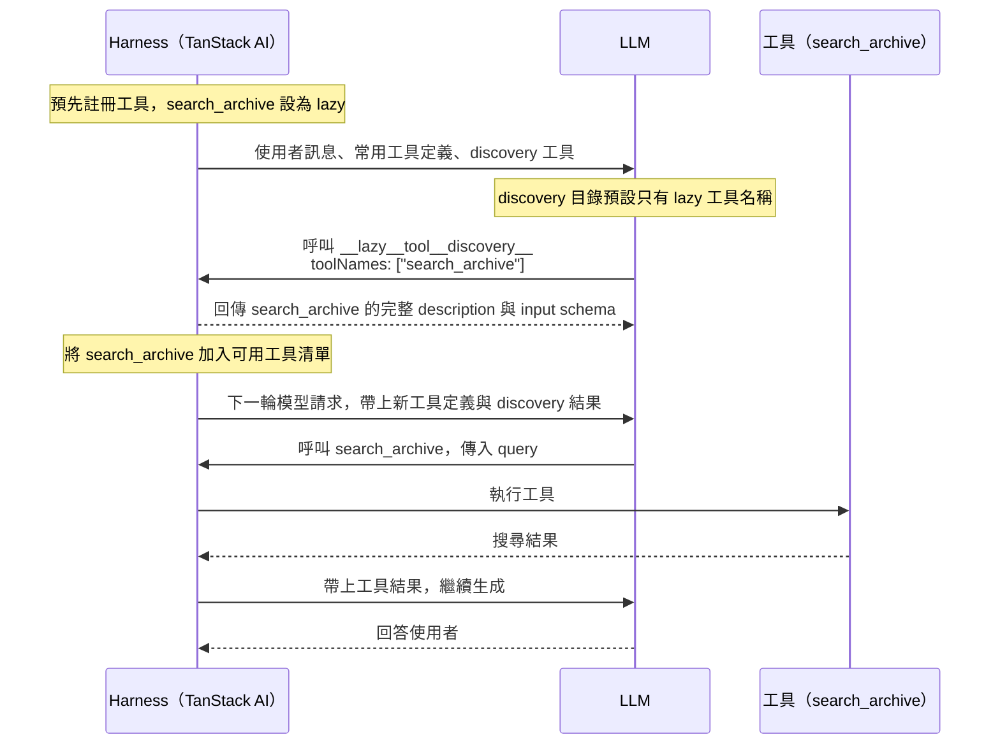
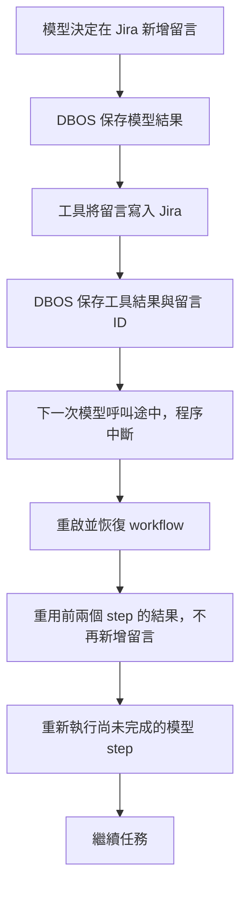
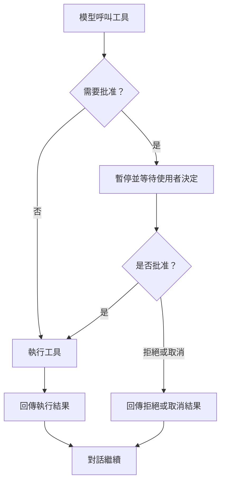

## Before Start

> [!NOTE]
> 此專案為教學用專案，透過 Coding Agent 建立 Harness 的系統，客製化自己的 Workflow。  
> 部分 Code 會使用手動編輯的方式，避免整個方向歪掉。  
> 不限定使用的 Agent 工具，以理解 Harness 觀念為主。  
> 我會使用 [PI](https://pi.dev/) 進行開發，搭配 [pstack](https://github.com/backnotprop/pstack)。

- [skills](https://github.com/tp6gw94/skills)
- [pi](https://github.com/tp6gw94/my-pi)


## 0. Intro

Agent = Model + Harness


好的 Harness 搭配不怎麼樣的模型能力可能大於強大的模型搭配不好的 Harness。

目標：建立會閱讀 Jira 和 Confluence 的 Agent，替我們撰寫 test case，並操作瀏覽器進行真實的測試，記錄下來結果。

## 1. Tool

LLM 要使用 tool 時，底層會透過特殊的 Token 進行輸出(通常在訓練後進行 fine-tuned 做處理)，以 `<|tool_call|>`, `<|end_tool_call|>` 當作範例，實際上這個 Token 不代表任何的文字：

```text
<|tool_call|>
{
  "name": "get_current_weather",
  "arguments": {
    "location": "Austin, TX, USA"
  }
}
<|end_tool_call|>
```

意思為要使用 `get_current_weather` 的這個 tool。

Harness 系統看到這 Token 的時候，瞭解到需要暫停 LLM 的執行，然後去執行這個 tool。

執行結束後，Harness 會以另一個標記，以`<|tool_result|>`, `<|end_tool_result|>` 告訴 LLM 執行的結果：

```text
<|tool_result|>
{
  "location": "Austin, TX, USA",
  "temperature": 93,
  "unit": "fahrenheit",
  "conditions": "sunny"
}
<|end_tool_result|>
```

這些特殊 token 無法由人類輸入產生，所以模型會知道哪些是 tool 執行的結果。

### MCP

被污名化已久的 Tool。

他就是 Tool，只是 MCP 內有很多的 Tool，所以佔滿了整個 context。

端看 Harness 會怎麼處理 MCP，像是 Lazy 或是手動處發。

MCP 就是包了許多外部 API 的 Tool。

### Lazy Load




### Tool Search (Manual)

透過定義 Search Tool，讓 LLM Search 相關使用的 Tool。

類似 Lazy，不過連 Tool Name 都不給 LLM，讓他可能依據使用者的輸入進行搜尋。

### Target

建立兩組工具，讓 Agent 讀取 Figma、Jira 與 Confluence，把整理結果寫入本機檔案，再讀回確認。

- [ ] 建立 `get_figma` 與 Pi fs 工具 `read`、`write`、`edit`。
- [ ] 接入本機唯讀 Atlassian MCP，使用 lazy discovery 載入工具。

依序閱讀以下文件：

1. [工具架構](docs/tools/architecture.md)：檔案分工、資料流與 lazy discovery 的用途。
2. [建立自訂工具](docs/tools/custom-tools.md)：get_figma、Pi fs、聊天整合與測試。
3. [接入本機 Atlassian MCP](docs/tools/atlassian-mcp.md)：連線政策、服務程序、client、串流清理與串接驗收。


## 2. Durable Execution

**Agent 已經修改 Jira 狀態或新增留言，程序卻在下一秒中斷，重啟後該從哪裡繼續？**

Durable Execution（持久化執行）會把每個步驟的結果存成 checkpoint（檢查點）。重啟後重用已完成的結果，從尚未完成的步驟繼續。設計 Harness 時，要把一次 Agent 呼叫拆成**可追蹤、可恢復，也能安全重試的執行流程**。

### 程序中斷後，哪些東西會消失？

以只把狀態存在記憶體的 Agent 為例，請它讀取 Jira ticket、改成「進行中」，再留言說明處理方向。執行途中按下 `Ctrl-C` 關掉伺服器，會遇到兩個問題。

1. 記憶體裡的 `messages` 陣列消失。重啟後，Agent 不知道先前做過哪些工作。
2. Jira 上的狀態與留言仍然存在。直接重跑整個任務，可能重複新增留言；已完成的狀態轉換也可能無法再次執行。

只加 retry 或保存對話紀錄都不夠。Harness 還需要知道哪些步驟已完成。修改 Jira 狀態與新增留言會改變外部系統，這類操作稱為副作用（side effect）。

### Harness 增加兩種持久化紀錄

兩者都存進 Postgres，但用途不同。

- **DBOS 保存執行進度**：透過 [DBOS](https://docs.dbos.dev)，把每次模型呼叫與工具呼叫包成 step，記錄完成結果。重啟後，已完成 checkpoint 的 step 直接重用結果，不再呼叫模型或工具。
- **Drizzle 保存事件紀錄**：把原本存在記憶體裡的事件寫進 Postgres，讓 inspector 在重啟後仍能重播整段執行時間線。

以下流程示範 Jira 留言已寫入、工具的 checkpoint 也已保存，下一次模型呼叫卻在途中中斷的情況。



Checkpoint 決定恢復時要執行哪些步驟；事件紀錄則讓人看得見執行過程。

### Checkpoint 與副作用之間的空窗

如果 Jira 已經接受狀態更新或新增留言，DBOS 還沒保存工具的 checkpoint，程序就中斷，恢復時仍可能再次執行該工具。**持久化執行不會自動讓外部副作用只發生一次。**

工具需要冪等設計，讓同一個操作重試時不會重複生效。更新狀態前，可以先確認 ticket 是否已在目標狀態；新增留言則需要固定的操作識別碼與去重機制，區分「重試同一則留言」和「刻意再留言一次」。

只在本地記錄「已完成」仍有空窗：Jira 寫入成功後，本地紀錄也可能尚未保存。去重流程必須能確認 Jira 上的寫入結果，不能只依賴 DBOS checkpoint 或本地旗標。

### Target

建立可在程序重啟後接續的聊天 run，讓模型呼叫、工具結果與執行進度都有明確的保存邊界。

- [ ] 接手原生 `chat()` 的工具迴圈，將模型呼叫與每個工具呼叫拆成 DBOS steps。
- [ ] 保存 run、事件與對話終態，讓背景工作和 SSE 連線分開，支援重啟恢復與前端重連。
- [ ] 建立 `discover_atlassian_tools`，從持久化訊息重建 lazy discovery 狀態。
- [ ] 驗證 checkpoint 前後中斷的差異，以及工具副作用的重試風險。

依序閱讀以下文件：

1. [可恢復的聊天架構](docs/durable-execution/architecture.md)：模組責任、資料流與 checkpoint 邊界。
2. [建立可恢復的 run](docs/durable-execution/implement-run.md)：資料契約、模型與工具 steps、runtime 及 SSE 重連。
3. [建立可恢復的 lazy discovery](docs/durable-execution/lazy-discovery.md)：工具目錄、discovery 結果與恢復後的執行檢查。
4. [驗證中斷與重連](docs/durable-execution/verify-recovery.md)：離線測試、真實程序中斷與交付驗收。

## 3.Code Mode

- LLM 訓練時的時候看過很多 Code，他們擅長寫 Code (好不好另說)
- 將 Tool 交給 LLM 當成程式執行省去好幾 Run 可以節省 token
- LLM 只讀取最後的結果

Code Mode 就是給 LLM 一個 Sandbox，讓他可以在裡面執行程式，我們給他有哪些定義好的 Function 可以執行。

讓他可以自由運用順序、讀取等。


### Target

- [ ] 提供 Code Mode

## 4. Compact

Compaction 用摘要取代較早的對話，讓 Agent 在有限的 context window 內繼續工作。它保留接續任務需要的資訊，但不保證保留每個細節。

### 對話為什麼需要壓縮

每次模型請求的 context 包含 system prompt、工具定義、對話訊息與工具結果。Agent 執行工具後，Harness 把結果加入下一次請求，因此即使你沒有再輸入訊息，context 也可能持續增長。

Context window 是模型一次能處理的 token 上限，容量依模型而異。超出限制時，API 可能拒絕請求。較長的 context 也不保證模型能充分利用每段資訊，但這不代表模型只讀開頭和結尾。

重新開始對話會移除累積的對話內容，代價是不再帶入先前決策與未完成工作的資訊。Compaction 則保留較短的摘要，讓任務延續。摘要會遺漏資訊，因此壓縮是在細節與可用空間之間取捨。

### 摘要與近期原文

以 Pi 的方式為例，Harness 根據可設定的 token 預算保留近期訊息，再把更早的內容交給模型摘要。保留量依內容長度決定，不是固定幾則訊息。切分時，工具呼叫與對應結果必須留在同一側，避免產生缺少結果或找不到呼叫的對話。

摘要使用獨立的模型請求。它有專用的 system prompt，要求模型整理上下文，而不是繼續回答原本的問題。舊對話先序列化成文字，再作為待整理的資料送入。歷史中的指令與工具呼叫不是新的執行要求，摘要請求也不提供工具供模型執行。

好的摘要像一份工作交接，重點是下一次模型請求需要知道什麼。結構化段落能讓資訊更容易查找，內容包括：

- 使用者的目標與限制。
- 已完成、進行中與受阻的工作。
- 已做的決策與理由。
- 下一步與尚未解決的問題。
- 接續工作所需的確切識別碼、路徑與工具結果。

再次壓縮時，上一份摘要與新累積的舊對話一起用來產生更新後的摘要。如此可延續先前的決策，而不必把多份摘要不斷堆進 context。反覆摘要仍可能遺漏細節，不能取代原始紀錄。

壓縮前後，模型收到的內容可以表示為：

```text
壓縮前
[system prompt][工具定義][較早的對話][近期訊息]

壓縮後的下一次請求
[system prompt][工具定義][摘要][近期訊息][新訊息]
```

### 壓縮門檻與執行時機

Harness 需要在 context window 用盡前預留空間，讓模型仍能產生回覆。Pi 以 context window 減去預留 token 數作為自動壓縮門檻，再比較目前的 context 大小。

檢查門檻不等於每次都產生摘要。Harness 可以在新請求前或工具結果加入後檢查，只有符合壓縮條件時才呼叫摘要模型。具體檢查位置取決於執行流程，不能把「每次檢查」理解成「每次壓縮」。

如果 API 已回報 context overflow，壓縮後重試可以作為補救，但必須限制次數。原封不動地重送超限請求不會縮小 context，無限制重試則會增加等待與成本。

### 聊天歷史與模型 context

保存原始歷史與縮小模型 context 是兩件事。Harness 可以持久化摘要及保留訊息的邊界，讓後續請求重建較短的 context，同時保存完整原始對話供介面顯示與查閱。

因此，介面仍看得到舊訊息，不代表模型每次都收到那些原文。模型能使用的是當次請求中的摘要與保留訊息。純文字摘要也不綁定特定模型，但切換模型不會恢復摘要中已遺漏的資訊。

### 壓縮對 prompt caching 的影響

Prompt caching 透過重用相同的輸入前綴，減少重複處理的成本。Compaction 把較早的對話換成摘要，從第一個不同的 token 起，原本的快取前綴就不再匹配。

即使近期訊息一字未改，它們前面的內容已改變，也無法沿用先前位置的快取。未變動的 system prompt 與工具定義仍可能重用快取，實際行為取決於供應商。後續請求若持續沿用新的前綴，就能再次累積可重用的快取。

壓縮本身也需要摘要請求，並可能增加壓縮後首個請求的處理成本。因此，減少 context 大小不等於每次壓縮都立即省錢。

延伸閱讀：[How Compaction Works in Pi](https://earendil.com/posts/compaction-in-pi/)。


### Target

1. [ ] 設定 Buffer，避免 touch 到限制，提早進行 Compact
2. [ ] 手動 Compact
3. [ ] BTW

## 5. Agent Routing / Subagent

每個 Agent 有各自的任務，各自可以使用的 Task。

目的：

1. 避免某個 Agent 的 context 被 Tool, Prompt 等塞滿
2. 有特殊的 Tool 權限要進行設定
3. 要各 Agent 使用不同的模型


### Target

1. Test Planner Agent
2. Test AC Agent
3. Test UI Agent
4. Atlassian Agent

## 6. User Approve



## 7. Eval

