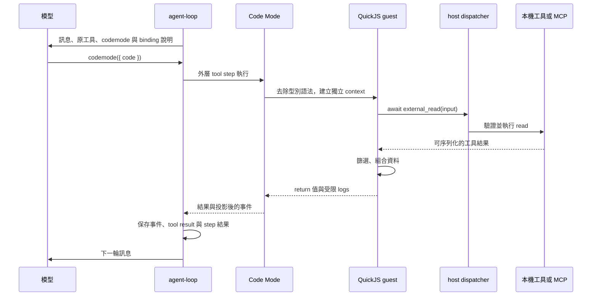

# Code Mode 的工具編排架構

這個 Target 要讓模型在一次 `codemode` 呼叫中，用 TypeScript 編排多個工具，再把整理後的結果交回聊天迴圈。先完成 [Tool Target](../tools/architecture.md) 與 [Durable Execution Target](../durable-execution/architecture.md)。

本章從尚未加入 Code Mode 的 Harness 開始。沿用本機工具、唯讀 Atlassian MCP、自訂 discovery 與 DBOS steps；不需要先完成 Compact、子 Agent 或批准流程。

## 程式決定工具的順序，Harness 保留執行權

一般工具迴圈讓模型決定一次呼叫，再把結果送回模型決定下一步。Code Mode 讓模型先寫出一段程式，在程式裡處理迴圈、條件與資料整理。例如讀取數個已知檔案，只回傳找到的段落。

模型仍能直接呼叫原本的工具。Code Mode 是另一種編排方式，不要求每個簡單查詢都改寫成程式，也不移除原工具的 schema。

本章使用 `@tanstack/ai-code-mode@0.4.13` 與 `@tanstack/ai-isolate-quickjs@0.3.1`。QuickJS 透過 WebAssembly 執行 JavaScript；TypeScript 先經過 `stripTypeScript` 去除型別語法。這個步驟不做型別檢查，也不決定操作權限。[TanStack 的 Code Mode 說明](https://tanstack.com/ai/latest/docs/code-mode/code-mode)描述了工具、型別宣告與執行 driver 的分工。

隔離環境中的程式稱為 guest，Node.js 伺服器稱為 host。Guest 不直接取得 host 的 `process`、檔案系統或網路 API。它只能透過已註冊的 `external_*` 函式要求 host 執行工具。

例如 `external_read` 回到 host 的 `read` handler，檔案仍由 host 讀取。開放這個 binding，就開放了該工具允許的讀取能力。隔離 JavaScript 執行環境不會縮小 handler 原有的權限。

## 檔案依責任拆分

依下列責任建立模組。檔名是實作方向，工具與 DBOS 的既有責任不搬進 sandbox。

- `server/harness/tools/code-mode.ts`：定義 `codemode` 輸入、建立 QuickJS 執行、轉接 bindings、限制資源，並整理結果與事件。
- `server/harness/tools/index.ts`：依當輪訊息組合可用工具，提供共同 dispatcher，再加入 `codemode` 定義。
- `server/harness/tools/atlassian.ts`：重建 discovery 狀態，檢查目錄與白名單，管理 MCP client，以及檢查已設定的 Atlassian 憑證。
- `server/harness/tools/fs.ts` 與 `get-figma.ts`：驗證工具參數並執行操作。直接呼叫與 Code Mode 共用相同 handler。
- `server/harness/prompts.ts`：根據真正的 bindings 產生函式說明與 TypeScript 宣告。
- `server/harness/agent-loop.ts`：把工具定義與 Code Mode prompt 送給模型，執行外層 tool step，將結果加入下一輪訊息。
- `server/harness/tool-events.ts`：限制自訂事件的數量與大小，依序交給既有事件儲存流程。

`code-mode.ts` 不建立新的聊天 run，也不直接寫入 `chat_events`。它接收 `definitions`、`dispatch`、`guard` 與執行政策，回傳工具定義、system prompt 和 execute 函式。

## 一次呼叫的資料流

`external_*` 是非同步函式。Driver 在 guest 與 host 之間轉換 JSON 資料，不把 MCP client、函式或 host 物件參照交給 guest。工具參數仍由 host 驗證。

模型不會因為內部呼叫了三個工具，就自動收到三份完整的工具訊息。外層只產生一個 Code Mode 結果，但其中仍可能包含 `result`、`logs` 或錯誤。若程式把原始資料全部 return 或印到 console，這些內容仍會進入結果；節省 context 取決於程式回傳什麼。

## Discovery 在 sandbox 外完成

沿用前一章的 `discover_atlassian_tools`。第一次模型請求提供本機工具、discovery 與 `codemode`。只有已探索且仍獲允許的 MCP 工具，才出現在後續的 bindings。

`codemode` 自身與 `discover_atlassian_tools` 不轉成 `external_*`。這避免程式遞迴建立另一個 sandbox，也讓一次執行的工具集合保持固定。模型先完成 discovery，保存結果，再於下一輪使用新 binding。

Prompt 的函式清單與型別宣告取自同一份 bindings。執行時也從伺服器保存的訊息重建工具集合，再由 dispatcher 檢查權限。模型猜到名稱、使用者文字聲稱已探索，或程式自行宣告同名函式，都不能增加 host 能力。

## DBOS 保存整段 Code Mode 的結果

沿用 `tool:<turn>:<index>` 的 checkpoint。一次 `codemode` 是一個外層 tool step，內部的多次 `external_*` 呼叫不是各自獨立的 DBOS steps。

已完成 checkpoint 時，恢復會重用整段結果。未完成 checkpoint 時，程式可能從頭執行，先前成功的 host 操作也可能再發生。子呼叫 ID 供追蹤使用，不會自動去重。詳細限制見[執行、隔離與恢復邊界](execution-boundaries.md)。

接著依照[建立 Code Mode](implement-code-mode.md)完成工具契約與聊天整合。
