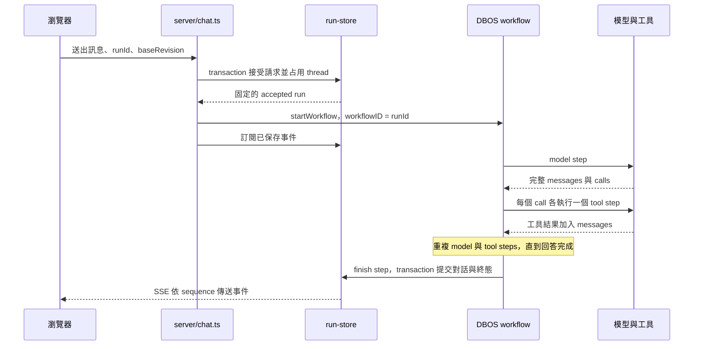

# 可恢復的聊天架構

這個 Target 要建立一條可在程序重啟後接續的聊天流程。模型呼叫、工具執行與對話完成各有 checkpoint，前端則從持久化事件重建畫面。

先完成 [Tool Target](../tools/architecture.md) 的工具定義與執行。這一章接手 `chat()` 原本管理的工具迴圈，保留 TanStack 的模型 adapter、訊息格式與串流處理。Code Mode、Compact、子 Agent 與批准流程留給各自章節。

## HTTP 連線與 run 的分工

一次使用者送出訊息是一個 run，一個 run 可以包含多輪模型呼叫。瀏覽器的 SSE 連線只觀察 run，不擁有 run 的生命週期。使用者重新整理頁面後，背景工作仍可繼續。

各個識別碼有不同用途：

- `threadId` 指向對話，`revision` 表示已提交的對話版本。
- `runId` 指向一次送出，也作為 DBOS 的 `workflowID`。重送同一個請求沿用此 ID。
- `turn` 與該輪工具的索引決定 step 順序，例如 `model:0`、`tool:0:0`。
- `toolCallId` 配對模型的工具呼叫與工具結果。
- `sequence` 是某個 run 的事件順序，供 SSE 重連使用，不代表 DBOS step 編號。

伺服器用 `baseRevision` 拒絕過期畫面送出的新 run，並限制同一個 thread 同時只有一個 pending run。只讓按鈕變成 disabled，無法阻止另一個分頁同時送出。

## 檔案依責任拆分

依照以下責任建立模組。檔名是實作方向，依賴由 HTTP 層往 workflow、儲存與工具層前進。

- `server/chat.ts`：驗證請求，接受 run，提供初始對話與 SSE 重連。這裡不執行模型或工具迴圈。
- `server/harness/run-store.ts`：接受請求、鎖定 thread、追加事件、提交終態，以及讀取待恢復的 run。所有應用資料庫寫入集中在這裡。
- `server/harness/run.ts`：註冊 DBOS workflow、以固定 ID 啟動工作、提供 checkpoint，並管理啟動、狀態核對與關閉。
- `server/harness/agent-loop.ts`：依序呼叫模型、執行每個 tool call、加入結果，直到模型不再要求工具或達到輪數上限。透過傳入的 checkpoint 函式切分工作。
- `server/harness/model-turn.ts`：消費一次模型串流，驗證事件完整性，回傳可序列化的 `{ messages, calls }`。這裡不執行工具。
- `server/harness/tools/index.ts`：組合模型可見定義、分派本機與 MCP 工具，管理每次 workflow 執行的工具資源。
- `server/harness/tools/atlassian.ts`：讀取 MCP 目錄、執行自訂 discovery、從已保存訊息重建已探索的工具名稱。
- `server/db/schema.ts` 與 `drizzle/`：定義應用資料表及 migration。`server/db/index.ts` 建立資料庫連線。
- `server/index.ts`：等待 runtime 啟動成功後才接收 HTTP，關機時依序停止服務。
- `src/hooks/use-threads.ts`：讀取對話、送出 run、重連事件串流，依伺服器終態更新畫面。

工具 handler 繼續負責參數驗證與外部操作。DBOS 邊界放在 handler 外面，讓同一個工具仍可獨立測試。

## Checkpoint 與事件各自保存什麼

DBOS system database 保存 workflow 輸入、狀態與 step 結果。應用資料表則保存使用者看得到的對話及 run 狀態：

- `threads` 保存已提交的 `messages`、`revision` 與 `active_run_id`。
- `chat_runs` 保存原始請求 `request`、伺服器接受時固定的 `accepted`、畫面快照 `projection`、`state` 與下一個事件序號。
- `chat_events` 保存 `run_id`、`sequence`、`event_key` 與事件內容。

`accepted` 包含從伺服器歷史組成的訊息、當次 prompt、model 與 workflow build。恢復時沿用這份輸入，不能重新讀取已改變的全域 prompt，再把它當成同一次執行。

`projection` 是供畫面讀取的訊息快照。模型重試前可回到最近的有效快照，再顯示新的串流。事件已寫入不代表 DBOS checkpoint 已完成，快照也不能取代 step 結果。

兩組資料可以使用同一個 Postgres，但 DBOS checkpoint 與 Drizzle 寫入仍是分開的提交。使用 [Drizzle transaction](https://orm.drizzle.team/docs/transactions) 只能讓該 transaction 內的應用寫入一起成功或回滾。

## 一個 run 的生命週期

接受請求與啟動 DBOS 之間存在空窗。因此 runtime 必須定期核對本地 pending run 與 DBOS 狀態，補啟動尚未建立的 workflow，或收尾已失敗的 workflow。

成功時，`finishRun` 在同一個 transaction 更新對話、增加 revision、釋放 `active_run_id`、追加 terminal event，並把 run 改為 `succeeded`。失敗時保存可查閱的輸出、釋放 thread，並改為 `failed`。重複收尾不再新增終態。

## 恢復時重新走流程，重用已完成的結果

[DBOS workflow](https://docs.dbos.dev/typescript/tutorials/workflow-tutorial) 恢復時會重新執行流程中的控制邏輯。已完成的 step 回傳 checkpoint 結果，尚未完成的 step 才執行工作。因此，每次恢復必須以相同輸入與已保存結果，走出相同的 step 順序。

模型請求、工具呼叫、資料庫寫入、時間與隨機值放在 step 內，或在接受 run 時先固定。Workflow 的迴圈只依據輸入和 step 結果決定下一步。Step 回傳資料，不能回傳 client、stream、函式或 `AbortController`。

一個 model step 包住完整的模型串流，不是每個 token 各一個 step。串流中斷後可能重做這次模型請求，畫面上的半段回答必須能被快照取代。工具 step 已完成 checkpoint 時，恢復會直接取得其結果，不再次執行 handler。

外部工具仍可能在「操作成功、checkpoint 尚未保存」時重跑。一般 HTTP 寫入沒有自動 exactly-once 保證。這一章沿用唯讀 Atlassian 工具，以測試用副作用驗證重試風險；實際可寫工具需要自己的操作 ID 與去重方式。

接著依照[建立可恢復的 run](implement-run.md)實作資料與執行流程。
