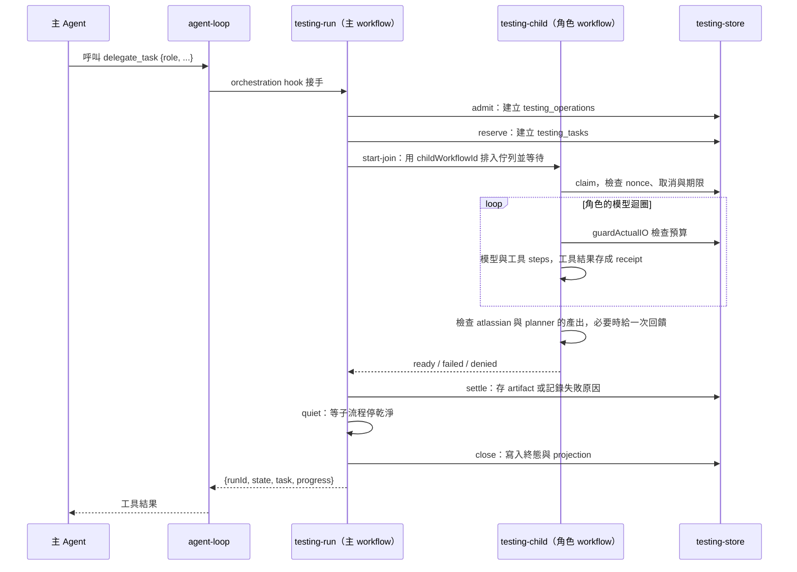

# 子 Agent 的委派架構

這個 Target 讓主對話的 Agent 把工作交給四個角色：`atlassian` 讀需求來源，`planner` 寫測試計畫，`ac` 與 `ui` 操作瀏覽器驗證。主 Agent 每次只委派一個角色，角色在自己的 DBOS workflow 裡執行，結果經過 host 驗證後存成不可變的 artifact，再交給下一個角色引用。

本章從 [Compact Target](../compact/architecture.md) 完成後的 Harness 開始。沿用 `agent-loop.ts`、DBOS steps、`chat_events` 事件紀錄、Code Mode 與 lazy discovery。不需要先完成批准流程。Jira 留言放在 [User Approve Target](../approval/architecture.md)。

## 為什麼要拆成子 Agent

只用一個 Agent 時，Jira 原文、Figma 節點、測試計畫和瀏覽器結果都會堆進同一份 context。拆成角色後，每個角色只收到自己需要的輸入：

- `planner` 只看到 `atlassian` 整理好的需求原文，看不到 MCP 工具。
- `ac` 收到完整計畫，但外部工具只有 `verify_ac`，而且只能執行分派給 `ac` 的功能檢查。
- 主 Agent 看到驗證過的 artifact ref 與內容，以及 `ac`、`ui` 寫的 findings，看不到角色的對話。

工具權限也跟著角色走。主 Agent 不能直接讀 Jira。`planner` 沒有任何外部工具。`ui` 的 `get_figma` 只能讀委派時指定的設計節點。權限寫在一個 registry 裡，主對話和每個角色都用同一個函式檢查。

## 檔案依責任拆分

依下列責任建立或修改模組。檔名是實作方向，不必逐字相同。

- `server/harness/agents.ts`：`agentRegistry`。每個 Agent 的模型、system prompt、工具、Code Mode 設定與產出的 artifact 種類。`allowsTool(agentId, name, route)` 是唯一的工具權限判斷。
- `server/harness/tools/delegate-task.ts`：`delegate_task` 工具定義，標記 `metadata: { direct: true }`，Code Mode 裡呼叫不到。
- `shared/testing.ts`：`delegationInputSchema`、`Source`、`PlanCase`、各種 check、evidence 與 handoff 的 zod schema，前後端共用。
- `server/harness/agent-loop.ts`：加入 orchestration hook。每個工具呼叫在進入 DBOS tool step 前，先交給 hook 判斷要不要接手。
- `server/harness/run.ts`：主對話的 hook `testingOrchestration`，把 `delegate_task` 交給 `delegateTask`。
- `server/harness/testing-run.ts`：主對話這一側的委派流程。依序執行 admit、reserve、start-join、drain、settle、quiet、close 七個 steps。
- `server/harness/testing-child.ts`：角色的 DBOS workflow，名稱是 `TESTING_WORKFLOW_VERSION`（目前是 `testing-child-v3`）。執行角色的模型迴圈、檢查產出、處理取消。
- `server/harness/testing-tools.ts`：依角色組合工具，限制 discovery、讀取範圍與 Figma 節點。
- `server/harness/testing-domain.ts`：`digestOf`、`assembleRequirements`、`canonicalizePlan`、`assembleToolResults` 等純函式，用來驗證角色產出，或從 receipt 組出結果。
- `server/harness/testing-store.ts`：`testing_*` 資料表的讀寫、IO 預算、取消與 projection。
- `server/harness/tools/use-browser.ts`、`playwright-check.ts`、`jev-client.ts`、`handoff-image.ts`：`verify_ac` 與 `verify_ui`。細節見[建立瀏覽器驗證](browser-verification.md)。
- `server/harness/prompts.ts`：主 Agent 的委派規則、四個角色的 system prompt、角色任務訊息與回饋訊息。
- `server/testing.ts`：`GET /api/testing/:runId` 與 `POST /api/testing/:runId/cancel`。
- `src/components/testing-panel.tsx`、`src/lib/testing-*.ts`：在 `delegate_task` 呼叫下方顯示角色進度與結果。

## 一次委派的資料流

角色的 workflow 不寫 `chat_events`。主 workflow 在 reserve 之後、quiet 迴圈裡每 200 毫秒，以及 close 時，把目前狀態整理成一份 projection。狀態有變時，才新增一個 `testing.projection` 事件寫進主對話的 run，瀏覽器沿用原本的 SSE 收到進度。

## 角色之間用 artifact 參照串起來

`delegate_task` 一次只接受一個角色，欄位依角色固定：

| role        | 必填欄位                          | 選填     |
| ----------- | --------------------------------- | -------- |
| `atlassian` | `summary`、`goal`、`sources`      | 無       |
| `planner`   | `summary`、`requirementsRef`      | `design` |
| `ac`        | `summary`、`planRef`、`targetUrl` | 無       |
| `ui`        | `summary`、`planRef`、`targetUrl` | 無       |

`atlassian` 成功後產生 `requirements` artifact，`planner` 用它的 ref 當 `requirementsRef`。`planner` 產生 `plan` artifact，`ac` 與 `ui` 用它的 ref 當 `planRef`。委派不會自動補跑前面的角色。缺少前置 artifact 時，`delegate_task` 回傳錯誤，由主 Agent 決定下一步。

artifact 屬於 thread。別的 thread 的 ref 會被拒絕。artifact 一旦寫入就不再修改，ref 由 operation、角色與內容的 digest 算出。

## Host 驗證產出，主 Agent 寫 QA 報告

角色的模型只「提出」結果，host 才「接受」結果：

- `atlassian` 不寫任何 JSON。host 從它成功讀取來源的工具紀錄（receipt）組出需求原文。
- `planner` 回傳 `{ criteria, unresolved, cases, deferredCases? }`。host 檢查 ID 不重複、每個 check 都指向存在的 criterion，再自己算出哪些 check 分給 `ac`、哪些分給 `ui`。
- `ac` 與 `ui` 在最後一回合寫純文字的 findings，不寫 JSON，也不引用 receipt。host 用 `assembleToolResults` 從 `verify_*` 的 receipt 組出每個 check 的工具觀察，存成 `ac-result` 或 `ui-result`。

`atlassian` 與 `planner` 第一次檢查不通過時，host 把問題當成一則使用者訊息送回角色，再給 2 輪。仍不通過，角色以 `proposal_rejected` 或 `source_reads_incomplete` 失敗，主 Agent 在工具結果裡看到原因與最多 8 條問題。`ac` 與 `ui` 的文字不經過檢查，所以沒有回饋輪。

`ac` 與 `ui` 的工具結果把輸入分開列出：

- `findings`：角色寫的文字，host 沒有評定內容。
- `result`：host 從 receipt 組出的工具觀察。角色失敗時，host 仍用已存下的 receipt 寫入這份結果。
- `missingChecks`：分派給這個角色、卻沒有任何工具觀察的 check。
- `conflictingChecks`：同一個 check 有多筆觀察，而且 outcome 不同。
- `progress`：只代表生命週期。

task 完成只代表執行結束，不代表檢查通過，也不代表報告完整。主 Agent 比對這些輸入，用自然語言寫 QA 報告。缺少的證據寫成限制。互相矛盾的觀察兩邊都留下，不挑一筆當成通過。

另一種做法是讓 `ac` 與 `ui` 回傳引用 receipt 的判定 JSON，再由 host 重算。這樣模型抄錯一個 digest，回饋 2 輪後仍錯，整個角色就失敗，瀏覽器已經跑完的觀察也進不了 artifact。現在判定直接來自 receipt，模型改不了判定，也不會因為格式錯誤丟掉觀察。模型的文字只負責 receipt 表達不了的部分：怎麼解讀差異，以及缺了哪些證據。

## DBOS 保證角色不重跑

每一層都用固定的 ID，恢復時找回同一筆紀錄，而不是建立新的：

- `operationId` 是 `testing-` 加上 `sha256(parentRunId + "\0" + toolCallId)` 的前 32 碼。同一個工具呼叫重放時拿回同一個 operation。
- `childWorkflowId` 是 `testing-<role>-` 加上 `sha256(TESTING_WORKFLOW_VERSION + "\0" + operationId + "\0" + role)` 的前 24 碼。DBOS 用 workflow ID 去重，重複排入佇列不會產生第二個子流程。
- 子流程裡每次模型請求與工具呼叫都是 DBOS step，恢復時重用結果，不再呼叫模型。
- 角色的結果寫入後，同一個 task 再次接受結果時，比對內容並回傳同一個 artifact ref。`ac` 與 `ui` 的 `findings` 也必須相同。
- `ac` 或 `ui` 的結果寫入後，host 拒絕再為這個 task 新增 receipt，工具觀察不會在寫入後改變。
- 期限在 admit 時固定為 15 分鐘，恢復後不延長。

瀏覽器操作是 DBOS 管不到的外部副作用。`verify_*` 每個 case 會先建立一個只能建立一次的標記檔，恢復後發現標記已存在，就直接回傳 `blocked`，不再開瀏覽器。

接著依照[建立委派](implement-delegation.md)完成 registry、`delegate_task` 與子 workflow。
