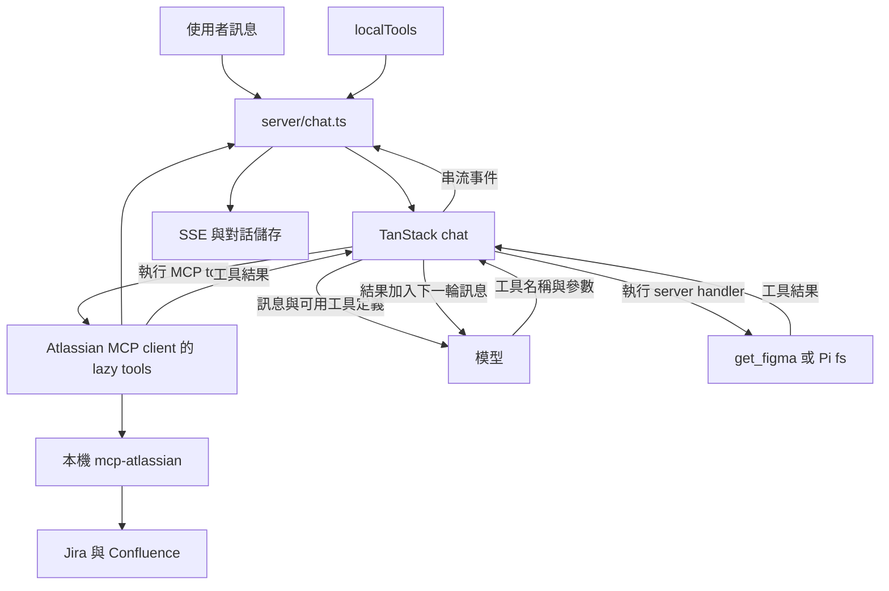

# 工具架構

這份設計讓 Agent 讀取 Figma、Jira 與 Confluence，把整理結果寫入本機檔案，再讀回確認。工具定義、工具執行與聊天整合分開，讓各部分可以獨立測試。

## 工具與聊天層的分工

工具迴圈採用 `@tanstack/ai@0.58.0` 的原生 `chat()`，MCP 連線採用 `@tanstack/ai-mcp@0.4.3`。預計依下列責任拆分檔案：

- `server/harness/tools/get-figma.ts`：定義 `get_figma` 的 schema、server handler 與結果格式。
- `server/harness/tools/fs.ts`：把 Pi 的 `read`、`write`、`edit` 轉成 TanStack tools。
- `server/harness/tools/read-worker.mjs`：執行 Pi read，讓主執行緒能取消讀取。
- `server/harness/tools/index.ts`：匯出自訂工具清單 `localTools`，不執行工具。
- `server/harness/tools/atlassian-policy.ts`：驗證設定，定義 endpoint、白名單與必要工具。
- `scripts/mcp-atlassian.ts`：依 policy 啟動及停止本機 MCP 子程序。
- `server/harness/tools/atlassian.ts`：連接 MCP、篩選原生工具，回傳 `{ tools, close }`。
- `server/chat.ts`：組合工具、呼叫 `chat()`、傳送 SSE、儲存對話，並管理每次聊天的 MCP client。

工具的 description 說明用途與限制，schema 描述參數，handler 驗證輸入並執行操作。聊天層負責 OpenUI prompt、SSE 與對話儲存，工具模組不處理這些工作。

## 工具結果回到模型的流程

`chat({ tools })` 接收工具清單。TanStack 處理模型的 tool call、執行對應 handler，再把結果交回模型繼續回答。

## Lazy discovery 與操作權限

獨立的 `mcp-atlassian` 程序透過 Streamable HTTP 提供 Jira 與 Confluence 原生工具。`lazy: true` 延後完整 schema 進入模型 context，client 仍會先連線並取得工具目錄。

Lazy 控制模型看到哪些 schema。唯讀設定、launcher 與 client 的白名單，以及 Atlassian 帳號權限，才限制可執行的操作。

實作指引從[建立自訂工具](custom-tools.md)開始。
